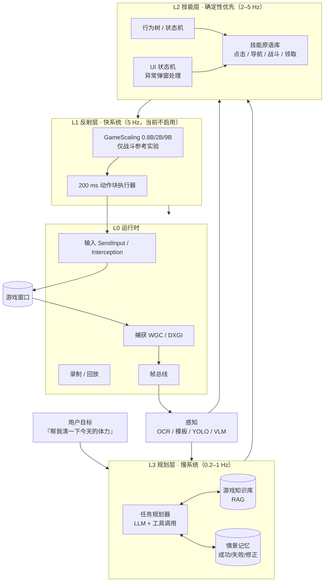

# KISEKI · 二次元游戏智能体

> 让 Agent 看着屏幕、理解局面、替你打完二次元游戏的日常。
> 当前状态：**v0.3 / M0 实机开发中**（2026-11-08 起）：`src/kiseki_runtime` 已有可运行的 MCP 运行时骨架（9 个工具面、`dry_run`、F12 急停、单元测试），界面锚点尚未上真机校准；`vendor/GameScaling` 为官方仓库镜像（不入库）。
>
> **v0.3 范围基线**：GameScaling 仅作参考；首发 **崩坏：星穹铁道（只测 UI）** 与 **明日方舟：终末地（地图 > 基建 > 战斗）**；DSH 作为 Agent 基座，主模型继续云端、只用小号。详见 [04-DSH集成与运行时方案](docs/04-DSH集成与运行时方案.md)。

---

## 一句话

不是"再写一个游戏脚本"，而是"**可迁移的二游副驾 / 代打 Agent**"：
**L3 规划（脑） + L2 技能（手眼） + L1 反射（肌肉）**，GameScaling 只做 L1。

## 三个核心判断

1. **GameScaling 是"手"，不是"脑"。** 它输出的是 200 ms 键鼠动作块，解决实时微操；二游日常的瓶颈在 UI 状态、任务规划、地图导航——这些它不做。**本项目里它只作参考实验，不排期。**
2. **"二游特化"不等于"画风特化"。** 真正决定难度的是：重 UI、长线日常、3D 卡通渲染、中日文文本，以及实时/回合制的时序差异；终末地的地图/基建又比战斗更接近"理解 + 规划"。
3. **多游戏适配靠"游戏无关内核 + 游戏适配包（Game Profile）"。** 北极星指标是：接入一款新游戏 ≤ 5 人日、20 个日常任务成功率 ≥ 85%。

## 目标架构



## 文档导航

| 文档 | 内容 |
|---|---|
| [总体方案](docs/01-总体方案.md) | 技术判断、能力边界、架构、子系统、多游戏适配、生态与合规 |
| [路线图与验收](docs/02-路线图与验收.md) | 12 周验证路线（v0.3）、WBS、预算、评测体系、风险登记册、Kill Criteria |
| [关键实验与数据计划](docs/03-实验与数据计划.md) | 星铁 UI 第一周清单、终末地地图/基建实验协议、GameScaling 参考实验 |
| [DSH 集成与运行时](docs/04-DSH集成与运行时方案.md) | DSH 能力边界、9 个 MCP 工具、Game Profile、时延预算、两周 MVP |
| [游戏适配包示例](configs/game_profile.example.yaml) | 一款新游戏需要声明什么 |
| [动作协议](schemas/action.schema.json) | 高层动作与 200 ms 底层动作块的统一 JSON Schema |

## 目录结构（规划）

```text
anime-game-agent/
├── docs/                    # 规划与设计文档
├── configs/
│   ├── game_profile.example.yaml
│   ├── hsr.yaml                 # 星铁 UI：窗口/锚点/OCR/任务
│   ├── endfield-map.yaml        # 终末地：小地图区域/瓦片/waypoint
│   └── profiles/                # 其余游戏一个 YAML
├── schemas/
│   └── action.schema.json
├── src/
│   ├── kiseki_runtime/          # DSH 的本地 runtime MCP（截图/输入/状态/技能/地图）
│   └── kiseki/                  # 感知、技能、规划、反射、评测（后续）
├── reports/                     # M0/M1 实验报告
├── tests/
└── vendor/GameScaling/          # 官方推理仓库（Apache-2.0，仅参考）
```

## 快速验证（M0，已可运行）

前置：Windows 11 + DSH 0.2.1-rc.5 + 星铁小号；第一周不需要本地 GPU。运行时零第三方依赖（Python 3.11+，纯 ctypes），先跑单元测试与自检：

```powershell
cd C:\AI\anime-game-agent
$env:PYTHONPATH="C:\AI\anime-game-agent\src"

# 1) 单元测试（离线：不注入输入、不需要游戏窗口）
python -m unittest discover -s tests

# 2) 运行时自检：枚举窗口 + 截一帧到 captures/selfcheck.png
python -m kiseki_runtime.mcp_server --self-check

# 3) MCP 冒烟：stdio 上一次 initialize + tools/list
'{"jsonrpc":"2.0","id":1,"method":"initialize","params":{}}' | python -m kiseki_runtime.mcp_server

```powershell
# 真实游戏只读冒烟（需要游戏正在运行；只 focus + 截图，不发送输入）
python scripts/smoke.py hsr --capture
```
```

```yaml
# 4) 在 C:\Users\ganch\.dsh\profiles\desktop\cordis.patch.yml 的 insert: 下加
- id: mcp-kiseki
  name: '@deepseek-ai/dsh-mcp-client'
  serverName: kiseki
  transport: stdio
  command: C:/AI/anime-game-agent/.venv/Scripts/python.exe
  args: [-m, kiseki_runtime.mcp_server]
  cwd: C:/AI/anime-game-agent
  env:
    PYTHONPATH: C:/AI/anime-game-agent/src
    PYTHONIOENCODING: utf-8
    PYTHONUTF8: '1'
  toolCallTimeoutMs: 30000
  failOnStartupError: false
```

重启 DSH 后，对话里应出现 `game_capture` / `game_act` 等工具；先用 `dry_run` 验证，不要直接点账号操作。

### 可选：GameScaling 参考实验（战斗，不排期）

需要 WSL2 + vLLM；当前 WSL 未安装。步骤见 [03](docs/03-实验与数据计划.md) §1。

## 合规声明

- 本项目用于**个人学习与研究**。多数二次元游戏的用户协议禁止自动化操作，使用自动代打存在**账号封禁**风险；请使用测试账号，并自行承担后果。
- 默认产品形态是**只读副驾（Copilot）**：只观察、提示、高亮，不注入输入；**代打（Autopilot）**是显式开启的高风险模式。
- 不读取/修改游戏内存，不注入 DLL，不绕过反作弊，不用于 PvP/竞技排名，不商业化外挂。
- 引用的开源项目（BetterGI、March7thAssistant、MAA 等）多为 GPL/AGPL：**参考架构可以，拷贝代码会传染许可证**，集成前必须做许可证审计。
- GameScaling 权重与代码为 Apache-2.0，但官方声明为"纯科学研究、无商业活动"；商用前需自行评估并取得授权。
