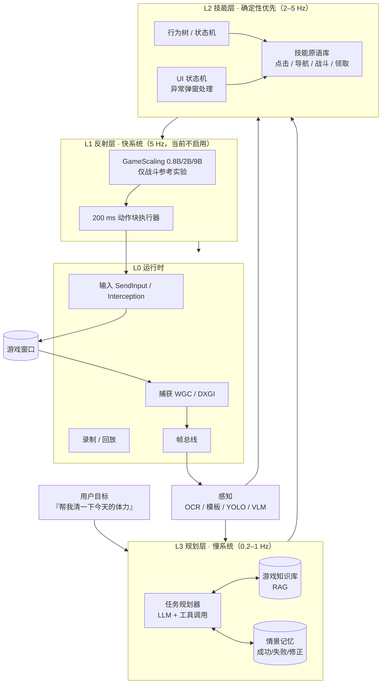

# KISEKI · 二次元游戏智能体

> 让 Agent 看着屏幕、理解局面、替你打完二次元游戏的日常。
> 当前状态：**v0.9 / M0 已跑通 + M1.0 模板匹配 + M1.1 OCR + M1.2 技能守卫 + M1.3 HID 传输层**（2026-11-08 起）：`src/kiseki_runtime` 提供 13 个 MCP 工具（含 `game_locate` / `game_wait_for` 模板匹配、`game_ocr` PaddleOCR 文本识别、`game_check` 技能前置/后置守卫、`dry_run`、F12 急停、58 个离线单测）；星铁已实机校准 42 个界面锚点，终末地只读定位可用（ACE 过滤合成输入）；`vendor/GameScaling` 为官方仓库镜像（不入库）。
>
> **v0.3 范围基线**：GameScaling 仅作参考；首发 **崩坏：星穹铁道（只测 UI）** 与 **明日方舟：终末地（地图 > 基建 > 战斗）**；DSH 作为 Agent 基座，主模型继续云端、只用小号。详见 [04-DSH集成与运行时方案](docs/04-DSH集成与运行时方案.md)。

---

## 一句话

不是"再写一个游戏脚本"，而是"**可迁移的二游副驾 / 代打 Agent**"：
**L3 规划（脑） + L2 技能（手眼） + L1 反射（肌肉）**，GameScaling 只做 L1。

## 三个核心判断

1. **GameScaling 是"手"，不是"脑"。** 它输出的是 200 ms 键鼠动作块，解决实时微操；二游日常的瓶颈在 UI 状态、任务规划、地图导航——这些它不做。**本项目里它只作参考实验，不排期。**
2. **"二游特化"不等于"画风特化"。** 真正决定难度的是：重 UI、长线日常、3D 卡通渲染、中日文文本，以及实时/回合制的时序差异；终末地的地图/基建又比战斗更接近"理解 + 规划"。
3. **多游戏适配靠"游戏无关内核 + 游戏适配包（Game Profile）"。** 北极星指标是：接入一款新游戏 ≤ 5 人日、20 个日常任务成功率 ≥ 85%。

## 目标架构



## 文档导航

| 文档 | 内容 |
|---|---|
| [总体方案](docs/01-总体方案.md) | 技术判断、能力边界、架构、子系统、多游戏适配、生态与合规 |
| [路线图与验收](docs/02-路线图与验收.md) | 12 周验证路线（v0.3）、WBS、预算、评测体系、风险登记册、Kill Criteria |
| [关键实验与数据计划](docs/03-实验与数据计划.md) | 星铁 UI 第一周清单、终末地地图/基建实验协议、GameScaling 参考实验 |
| [DSH 集成与运行时](docs/04-DSH集成与运行时方案.md) | DSH 能力边界、9 个 MCP 工具、Game Profile、时延预算、两周 MVP |
| [维护与运营](docs/06-维护与运营.md) | public 后的日常运营：隐私守卫、superagent 常驻、人审合并、看门狗 |
| [游戏适配包示例](configs/game_profile.example.yaml) | 一款新游戏需要声明什么 |
| [动作协议](schemas/action.schema.json) | 高层动作与 200 ms 底层动作块的统一 JSON Schema |

## 目录结构（规划）

```text
anime-game-agent/
├── docs/                    # 规划与设计文档
├── configs/
│   ├── game_profile.example.yaml
│   ├── hsr.yaml                 # 星铁 UI：窗口/锚点/OCR/任务
│   ├── endfield-map.yaml        # 终末地：小地图区域/瓦片/waypoint
│   └── profiles/                # 其余游戏一个 YAML
├── schemas/
│   └── action.schema.json
├── src/
│   ├── kiseki_runtime/          # DSH 的本地 runtime MCP（截图/输入/状态/技能/地图）
│   └── kiseki/                  # 感知、技能、规划、反射、评测（后续）
├── reports/                     # M0/M1 实验报告
├── tests/
└── vendor/GameScaling/          # 官方推理仓库（Apache-2.0，仅参考）
```

> 仓库状态：**public**（2026-11-08 起）。提交前会自动跑隐私守卫测试（`tests/test_privacy.py`），
> 确保本机路径、游戏 UID、token 等不出现在被跟踪文件里。

## 快速验证（M0 已跑通，M1.0 模板匹配 + M1.1 OCR 已接入）

前置：Windows 11 + DSH 0.2.1-rc.5 + 星铁小号。核心运行时零第三方依赖（Python 3.11+，纯 ctypes）；模板匹配需要 OpenCV，OCR 需要 PaddleOCR（都是可选安装）。PaddleOCR 依赖较重，建议装进仓库内的独立 venv：

```powershell
cd C:\AI\anime-game-agent
python -m venv .venv
.\.venv\Scripts\python.exe -m pip install -e .[vision,tools,ocr]
$env:PYTHONPATH="C:\AI\anime-game-agent\src"

# 1) 单元测试（离线：不注入输入、不需要游戏窗口）
python -m unittest discover -s tests

# 2) 运行时自检：枚举窗口 + 截一帧到 captures/selfcheck.png
python -m kiseki_runtime.mcp_server --self-check

# 3) MCP 冒烟：stdio 上一次 initialize + tools/list
'{"jsonrpc":"2.0","id":1,"method":"initialize","params":{}}' | python -m kiseki_runtime.mcp_server

# 4) 真实游戏只读冒烟（需要游戏正在运行；只 focus + 截图，不发送输入）
python scripts/smoke.py hsr --capture
```

截图默认按 profile 的 `capture.scale` 下采样（`hsr` / `endfield-map` 当前 `0.5` → 1280x800），单次调用可用 `game_capture(scale=1.0)` 覆盖。

### M1.0 模板匹配（视觉感知第一步）

```powershell
# 生成/刷新真机模板：抓 in-game / phone / map 三态截图，按锚点 region 裁图
$env:PYTHONPATH="C:\AI\anime-game-agent\src"
python scripts/build_templates.py hsr --write-config
```

- 模板与索引在 `assets/templates/<game>/<state>/`；`index.json` 记录每张图的来源状态、尺寸与 region。
- MCP 侧直接按锚点使用（锚点已带 `template:`）：
  - `game_locate(anchor="hud_chat")` → `found / score / rect / normalized_center`；
  - `game_wait_for(anchor="phone_close", timeout=5)` → 轮询到出现为止，超时返回 `ANCHOR_NOT_FOUND`。
- 两个工具都只读、不发输入；`score` 是 `cv2.TM_CCOEFF_NORMED` 灰度匹配分数。
- 未安装 OpenCV 时返回 `VISION_UNAVAILABLE`，其余工具照常工作。

### M1.1 OCR（PaddleOCR，字体特殊 / 背景复杂 / 中文小字）

```powershell
# 安装 OCR 额外依赖（重：paddlepaddle + paddleocr，含模型下载）
.\.venv\Scripts\python.exe -m pip install -e .[ocr]

# MCP 侧直接调用（只读，不发输入）
# game_ocr(game_id="hsr", anchor="mail_icon")            → 只识别该锚点区域
# game_ocr(game_id="hsr", region=[0.0,0.0,1.0,1.0])      → 全窗口
# game_ocr(game_id="hsr", min_confidence=0.8, language="ch")
```

- 返回 `lines[]`：`text` / `score` / `rect`（客户区像素）/ `normalized_rect` / `normalized_center`（0..1，可直接喂给 `game_act`）；阈值默认 0.5，`language` 默认 `ch`。
- `preset` 选模型：`accurate`（默认，PP-OCRv6_medium，实机约 7.5 s/帧，`派对车厢` 置信度 0.999）或 `fast`（PP-OCRv5_mobile，实机约 1.4 s/帧，适合轮询 HUD）。首次调用含引擎初始化（约 5–17 s），之后按 preset 进程内缓存。
- 模型首次运行会自动下载缓存（`~/.paddlex/official_models`）；未安装 PaddleOCR 时返回 `OCR_UNAVAILABLE`，其余工具照常工作。
- 引擎为进程内缓存（单例），第一次识别包含初始化耗时，之后单帧通常在百毫秒级。


### M1.2 技能守卫（require / confirm）

profile 里可以声明命名的只读检查，技能在动作前后自动评估，避免"盲点坐标"：

```yaml
checks:
  in_game:    { anchor: hud_chat,   present: true, threshold: 0.8 }
  phone_open: { anchor: phone_close, present: true, threshold: 0.8 }
  mail_open:
    ocr: { region: [0.02, 0.02, 0.30, 0.12], contains: 短信, preset: fast }

skills:
  - id: phone_close
    require: [phone_open]   # 前置：手机必须先打开
    confirm: [in_game]      # 后置：关闭后应回到游戏主界面
    actions: [...]
```

- `game_check(game_id="hsr", check="in_game")` → `passed` + `detail`（模板分数或 OCR 命中行），只读、不发输入。
- `game_skill` 先跑 `require`：不满足直接返回 `SKILL_PRECONDITION`，**不会发出任何输入**；动作执行后再跑 `confirm`：不满足返回 `SKILL_POSTCONDITION`，并附带已执行的动作结果。
- 真机实测（2026-11-08）：`enter_game` 77.1 s 后 `in_game` 0.9999；`phone_open` 1.6 s、`phone_close` 1.3 s，前置/后置均 0.9999；手机已关闭时再次 `phone_close` 被前置守卫拦下、零输入。


### M1.3 HID 输入通道（CH9329，硬件待接入）

ACE 会过滤 `SendInput` 合成输入（终末地实测：所有合成键鼠事件被丢弃），而**硬件 HID** 在反作弊眼里就是真实键鼠。`src/kiseki_runtime/hid_serial.py` 已实现 CH9329 串口协议层（离线可测，不需要硬件）：

- 帧构造：`frame(cmd, data)`、`keyboard_frame(modifier, keys)`、`mouse_frame(buttons, dx, dy, wheel)`，校验和 = 前面所有字节之和 & 0xFF；
- 相对移动分片：单帧每轴限 ±127（`axis_chunks`），默认 10 ms 报告间隔；
- 键位映射：字母/数字/方向键/F1–F12/Esc/Enter 等 USB HID usage id，Ctrl/Shift/Alt/Win 修饰位；
- `Ch9329(port="COM3", baudrate=115200)`：`info()` 探链路、`move()`、`click()`、`press()`/`release()`/`tap()`；pyserial 未装时返回 `HID_UNAVAILABLE`（`pip install -e .[hid]`）。

当前已把传输层接进执行器（M1.3b）：

```yaml
# configs/<game>.yaml
input:
  backend: hid-serial      # 默认 sendinput；改成 hid-serial 即走串口 HID
  serial:
    port: COM3             # CH9329 插上后设备管理器里看到的端口
    baudrate: 115200
```

- `src/kiseki_runtime/input_backend.py`：`SendInputBackend`（默认）与 `HidSerialBackend`；后者用相对报告移动光标，并读 `GetCursorPos()` 做闭环（容差 2px，40 次迭代上限，超时抛 `HID_MOVE_TIMEOUT`），键位状态机负责 down/up/tap 组合键。
- `execute_actions(..., backend=...)` 走统一接口，`game_act` 按 profile 的 `input.backend` 自动选择；`game_stop` 会同时释放两种后端的按键/按钮。
- 没有硬件时所有逻辑都可用 `FakeTransport` + 假光标离线测试（`tests/test_input_backend.py`，13 个用例）。

### M1.6 按文字点击（click_text）

`game_act` 的动作里可以写 `type: click_text`：运行时先 OCR 当前帧（或指定 region），
按文字找到目标（精确匹配优先，其次子串、再按置信度取最高），把它解析成归一化坐标的
`click` 再执行；找不到时抛 `TEXT_NOT_FOUND`（带当前帧可见文字，方便排查）。

```python
runtime.game_act("hsr", [{"type": "click_text", "text": "短信", "region": [0.60, 0.40, 0.95, 0.85]}], dry_run=True)
# -> {"planned": [{"kind": "click", "target": "normalized", "normalized": [0.35, 0.42], ...}],
#     "text_matches": [{"text": "短信", "matched_text": "短信", "score": 0.99, ...}]}
```

`dry_run` 时同样会做 OCR 但不发送输入；`text_matches` 会随结果返回，便于判断匹配质量。

## M1.5 感知型等待（check waits）

技能里的固定 `sleep` 换成「等到某个感知状态成立」：`wait` 的 `condition.kind` 新增 `check`，
由 profile 顶部 `checks:` 的模板/OCR 检查驱动，超时抛 `CHECK_TIMEOUT`（带 `attempts`/`last`）。

```yaml
skills:
  - id: phone_open
    require: [in_game]
    confirm: [phone_open]
    actions:
      - {type: key, keys: [esc], action: tap}
      - {type: wait, condition: {kind: check, name: phone_open, timeout: 8, interval: 0.25}}
```

实测（星铁）：`open_mail` 的后置等待 `mail_open` 用 fast OCR 约 1.4 s/次轮询；
`enter_game` 也改成 check 等待：`wait check title_screen timeout 120` → 点「点击进入」→
`wait check in_game timeout 120`，冷启动不再依赖 42/35 s 的固定秒数。`title_screen` 用 OCR
（fast 预设，region [0.40, 0.92, 0.62, 0.99]，contains 点击进入），在历史标题画面截图上实测
score 0.9932。

把等待条件写成不可能成立的 check（`mail_open` 在战斗场景）时，1.0 s 预算在 7.71 s 抛
`CHECK_TIMEOUT`（首次 OCR 含引擎加载，超时是下界不是硬上限）。

## M1.4 只读技能链（短信界面）

在 M1.2 的守卫之上补了三个只读技能，串起「打开手机 → 读短信列表 → 返回」：

```yaml
checks:
  mail_open: {ocr: {region: [0.02, 0.02, 0.30, 0.12], contains: 短信, preset: fast}}

skills:
  - id: open_mail       # require: [phone_open]   confirm: [mail_open]
  - id: back_to_phone   # require: [mail_open]    confirm: [phone_open]
```

实机（2026-11-08 21:48，星铁 4.6.0）：`phone_open` → `open_mail`（后置 OCR `短信` 0.9999）→ OCR 列表 11 行/4.3 s → `back_to_phone` → `phone_close`，每一步的前置/后置都真实求值，不满足时零输入。只读链路，不点任何领取按钮。

### 在 DSH 中挂载

```yaml
# 在 <HOME>\.dsh\profiles\desktop\cordis.patch.yml 的 insert: 下加
- id: mcp-kiseki
  name: '@deepseek-ai/dsh-mcp-client'
  serverName: kiseki
  transport: stdio
  command: C:/AI/anime-game-agent/.venv/Scripts/python.exe
  args: [-m, kiseki_runtime.mcp_server]
  cwd: C:/AI/anime-game-agent
  env:
    PYTHONPATH: C:/AI/anime-game-agent/src
    PYTHONIOENCODING: utf-8
    PYTHONUTF8: '1'
  toolCallTimeoutMs: 30000
  failOnStartupError: false
```

重启 DSH 后，对话里应出现 `game_capture` / `game_act` / `game_locate` 等工具；先 `dry_run` 验证再实操。

### 可选：GameScaling 参考实验（战斗，不排期）

需要 WSL2 + vLLM；当前 WSL 未安装。步骤见 [03](docs/03-实验与数据计划.md) §1。

## 合规声明

- 本项目用于**个人学习与研究**。多数二次元游戏的用户协议禁止自动化操作，使用自动代打存在**账号封禁**风险；请使用测试账号，并自行承担后果。
- 默认产品形态是**只读副驾（Copilot）**：只观察、提示、高亮，不注入输入；**代打（Autopilot）**是显式开启的高风险模式。
- 不读取/修改游戏内存，不注入 DLL，不绕过反作弊，不用于 PvP/竞技排名，不商业化外挂。
- 引用的开源项目（BetterGI、March7thAssistant、MAA 等）多为 GPL/AGPL：**参考架构可以，拷贝代码会传染许可证**，集成前必须做许可证审计。
- GameScaling 权重与代码为 Apache-2.0，但官方声明为"纯科学研究、无商业活动"；商用前需自行评估并取得授权。
