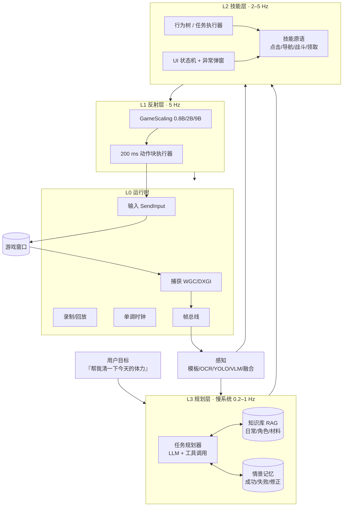

# 01 · 总体方案

> 版本 v0.1 · 2026-11-08 · 讨论稿
> 项目：KISEKI（轨迹）· 二次元游戏智能体
> 配套文档：[路线图与验收](02-路线图与验收.md) · [实验与数据计划](03-实验与数据计划.md) · [DSH 集成与运行时](04-DSH集成与运行时方案.md)
>
> **v0.3 范围基线（2026-11-08）**：GameScaling 仅作参考；首发 **星穹铁道（只测 UI）** 与 **终末地（地图 > 基建 > 战斗）**；DSH 作为 Agent 基座，主模型继续云端、只用小号。详见 [04-DSH集成与运行时方案](04-DSH集成与运行时方案.md)。本文的 P1 原神 / P2 ZZZ 保留为长期规划。

---

## 0. 一页结论

| 问题 | 结论 |
|---|---|
| 项目是什么 | **可迁移的二游副驾 / 代打 Agent**：L3 规划（脑）+ L2 技能（手眼）+ L1 反射（肌肉） |
| GameScaling 怎么用 | **L1 反射层**，负责 3D 动作微操；不是全栈方案，先做 M0 零样本判定再决定投入 |
| 先做哪款游戏 | **崩坏：星穹铁道**：重 UI、回合制、时序宽松，最适合先把 L2/L3 跑通 |
| 多游戏怎么实现 | **游戏无关内核 + 每游戏 Game Profile YAML**；接入目标 ≤ 5 人日 |
| 多久有东西看 | 2 周闭环 Demo；8 周 v0.1；16 周 v0.5；24 周 v1.0 |
| 最大风险 | 反作弊/ToS（高）、GameScaling 二游域迁移（中高）、规划幻觉误操作（中高） |
| 北极星 | 20 个日常任务成功率 ≥ 85%，人工干预 ≤ 0.2 次/任务，新游戏接入 ≤ 5 人日 |

**三个核心判断：**

1. **GameScaling 是"手"，不是"脑"。** 它输出 200 ms 键鼠动作块，解决实时微操；二游日常的瓶颈在 UI 状态、任务规划、地图导航——这些它不做。
2. **"二游特化"不等于"画风特化"。** 决定难度的是重 UI、长线日常、3D 卡通渲染、中日文文本，以及回合制/高速动作的时序两极化。
3. **先建闭环，再谈模型。** 没有捕获、输入、录制、回放、评测，就无法判断 GameScaling 到底行不行；闭环本身就是最早的可交付价值。

---

## 1. 项目定义

### 1.1 问题

二次元游戏的"日常"高度重复：登录 → 领邮件/签到 → 清体力 → 周常 → 活动 → 抽卡/养成。玩家每天花 20–60 分钟做机械操作，真正想玩的是剧情、角色和战斗策略。

现有方案分两类：

- **脚本/图像识别派**（BetterGI、March7thAssistant、MAA、StarRailCopilot）：稳定、快，但每款游戏都要手写流程，遇到新界面/新活动就断，几乎没有"理解"。
- **端到端模型派**（GameScaling、NitroGen、VLA）：泛化潜力大，但只解决"手"的问题；对重 UI、2D、长时任务无能为力。

**本项目要补的空白**：一个"看得懂界面、记得住任务、知道下一步做什么、手也能动"的分层 Agent，并且把"接入一款新游戏"的成本压到几天。

### 1.2 三层目标

| 层 | 目标 | 可验证结果 |
|---|---|---|
| 产品层 | 二游玩家的副驾/代打：一句话完成日常 | HSR 20 个日常任务 ≥ 85%，人工干预 ≤ 0.2 次/任务 |
| 技术层 | 可迁移的分层 Agent 架构 + 游戏适配包 + 自采数据 SFT | 接入新游戏 ≤ 5 人日；L1 战斗较脚本基线 +10% 胜率 |
| 研究层 | 二游日常的评测基准与实证 | AnimeGameBench（3 游戏 × 10–20 任务）+ 技术报告 |

### 1.3 非目标

- 不追求"所有游戏都能玩"；只覆盖二次元品类里的五种交互形态（见 §3.2）。
- 不做 PvP、竞技排名、速通竞速。
- 不做商业化外挂、账号交易、代练服务。
- 不读取/修改游戏内存，不注入 DLL，不绕过反作弊。
- 不替代玩家的剧情选择与角色养成决策；只做"可委托的重复操作"。

### 1.4 成功标准

| 版本 | 时间 | 范围 | 硬指标 |
|---|---|---|---|
| v0.1 | 8 周 | HSR 5 个日常任务 | 20 次运行成功率 ≥ 90%；L2 回路 p95 < 300 ms；全量回放可用 |
| v0.5 | 16 周 | 2 款游戏、20 个任务 | 成功率 ≥ 80%；自然语言下达目标；新游戏接入 ≤ 5 人日 |
| v1.0 | 24 周 | 3 款游戏、40 个任务 | 成功率 ≥ 85%；战斗胜率较脚本基线 +10%；基准与技术报告发布 |

> 成功率的统计口径：每个任务独立运行 N=20 次，按 Wilson 95% 置信区间报告；发布门槛用 N=50。

---

## 2. 关键判断：GameScaling 是 L1，不是全栈

### 2.1 核查后的事实（2026-11-08）

| 维度 | 事实 |
|---|---|
| 基座 | Qwen3.5-VL 0.8B / 2B / 9B / 27B |
| 训练 | 1600 小时键鼠录像继续预训练（CPT），80 款游戏，120 个训练配置（S1–S5） |
| 输入 | 当前帧 + 短历史（默认 5 帧）+ 系统提示词（游戏名/规则/键位） |
| 输出 | 200 ms 动作块 = 6 × 33 ms；鼠标千分位 ±1000；滚轮 ±5；每步 ≤ 4 键；74 键词表 |
| 部署 | vLLM ≥ 0.17，OpenAI 兼容；bf16 权重 2.2 / 5.4 / 18.8 / 54.7 GB |
| 延迟 | 官方单步 0.13–0.69 s；前沿模型 4–24 s |
| 效果 | ViZDoom 实时 11.5（9B-S3）；MCU 50.9% → 69.3%（9B-S1，600 → 3000 步） |
| 开源 | **只有推理客户端/提示词/示例/测试**；无训练代码；游戏数据不发布；Apache-2.0 + "纯科学研究"声明 |
| 算力 | 论文训练总算力 2.2 × 10²² FLOPs |

### 2.2 它能做什么、不能做什么

| 任务 | 能力 | 说明 |
|---|---|---|
| 3D 动作微操 | **强**（训练分布内） | 移动、视角、射击、闪避的 200 ms 级连续控制 |
| 未见过的 3D 游戏 | 中 | 论文：related worlds 有迁移，distant worlds 有限 |
| UI 点击/菜单 | **弱/不可用** | 动作空间没有绝对坐标；5 Hz 相对鼠标点菜单又慢又抖 |
| 2D/2.5D/重 UI | 弱 | 属于论文里的 distant world |
| 任务规划/知识 | **无** | 没有任务记忆，也没有"今天该刷什么"的知识 |
| 长时任务 | 无 | 上下文只有几帧，跑完一个副本就会漂移 |

**结论**：GameScaling 适合做"原神/ZZZ 战斗与跑图"的 L1；HSR 的回合制战斗、菜单、对话完全不该用它。

### 2.3 训练代码缺失意味着什么

官方未开源训练代码，但这不是死路：

1. **权重是标准 Qwen3.5-VL checkpoint**，自带 chat_template，可用 ms-swift / LLaMA-Factory 做 SFT。
2. **缺的是 CPT 数据管线与损失细节**，不是模型结构；用自采数据做行为克隆（BC）可以近似"继续预训练"的效果。
3. **不要复现 CPT**：2.2 × 10²² FLOPs，单张 4090 以"年"计。复现是研究机构的活，不是个人项目。

三条绕行路径：

| 路径 | 做法 | 成本 | 风险 | 何时选 |
|---|---|---|---|---|
| A 零样本 + 提示词适配 | 部署 2B/9B，改 GAME_RULES/KEY_BINDINGS，直接跑 | 1 周 | 二游域迁移可能很差 | 先做，拿数据 |
| B 自采数据 SFT | 录制自己的操作，BC 微调 2B-S3 | 4–8 周 | 需要闭环与数据管线 | M0 黄/绿且想提升 |
| C 脚本化 L1 | 战斗宏 + 模板/OCR 状态机 | 2–3 周 | 不泛化，但稳定 | 保底，永远保留 |

**决策门（M0）**：零样本"合理动作率" ≥ 50% → 走 A→B；30–50% → 只做 A 的研究支线，产品用 C；< 30% → GameScaling 不进产品路径，只保留论文复现/学习价值。

### 2.4 结论：分层混合，而不是二选一

- **确定性优先**：能用模板/OCR/状态机解决的，不用模型。
- **神经兜底**：只有"连续动作、模糊语义、未知界面"才调用 VLM/GameScaling。
- **逐层降级**：L1 失败 → 脚本宏；脚本失败 → L2 重试；L2 失败 → L3 重规划；L3 失败 → 人工。
- **一句话**：脚本是骨架，模型是肌肉，LLM 是大脑；三者用同一套动作协议连接。

---

## 3. 二游特化：到底特化什么

### 3.1 四个技术特征

| 特征 | 表现 | 对系统的影响 |
|---|---|---|
| **重 UI** | 菜单、页签、红点、弹窗、长列表、确认框 | 需要 UI 状态机 + OCR + 模板；点击必须用绝对坐标，不能用 GameScaling |
| **长线日常** | 每日/每周/活动/体力/邮件 | 需要任务库、调度、情景记忆；不是"单局游戏" |
| **3D 卡通渲染** | 描边、高饱和、Bloom、粒子、动态模糊 | 模板匹配与 OCR 需预处理；VLM 对语义判断有帮助 |
| **中日文文本** | 风格化字体、描边、渐变、多语言 | OCR 选型与后处理；需要字典纠错与置信度门控 |
| **时序两极化** | 回合制（慢） vs 高速动作（快） | 同一套架构要能按游戏开关 L1；延迟预算分开定 |

**关键洞察**：决定技术难度的是"交互形态 + UI 密度 + 实时性"，不是"画风"。所以"二游特化"应该特化在**这四类特征**上，而不是训练一个"二次元画风识别模型"。

### 3.2 五种交互形态

| 形态 | 代表 | CV 难度 | 实时性 | 主要用到的层 |
|---|---|---|---|---|
| 回合制/指令 | 崩坏：星穹铁道、FGO | 中（UI 多） | 低 | L2 + L3 |
| 开放世界动作 | 原神、鸣潮 | 高（3D + 地图） | 中 | L1 + L2 + L3 |
| 箱庭高速动作 | 绝区零、战双 | 高 | 高 | L1 + L2 |
| 2D 塔防/放置 | 明日方舟、碧蓝航线 | 中 | 低–中 | L2 + CV |
| 卡牌/养成 | 赛马娘、蔚蓝档案 | 低–中 | 低 | L3 + UI |

### 3.3 首批目标与选择理由

| 优先级 | 游戏 | 为什么选它 | 主要验证 | 反作弊风险 | 参考项目 |
|---|---|---|---|---|---|
| P0 | 崩坏：星穹铁道 | 回合制、重 UI、时序宽松、日常任务多 | L2 技能 + L3 规划 + 全链路 | 中（mhyprot 系） | March7th、StarRailCopilot |
| P1 | 原神 | 开放世界、导航/采集/战斗，L1 的最佳试验场 | L1 + 地图导航 | 中高 | BetterGI |
| P2 | 绝区零 | 高速动作，压 L1 延迟极限 | L1 实时性 | 中高 | 无成熟开源 |
| P3 | 明日方舟（模拟器） | 2D、纯 CV、无 3D，压力测试感知管线 | CV/OCR 泛化 | 低（模拟器） | MAA |

**为什么 P0 不是原神**：原神把 L1、地图、3D 导航、反作弊全部叠在一起，首战即决战；HSR 把"UI 理解 + 任务规划 + 技能编排"单独隔离出来，8 周能出可评测的结果。

### 3.4 合规红线

- 多数二游用户协议禁止第三方自动化；**封号风险由使用者承担**。
- 默认 **Copilot**（只读、提示、高亮），**Autopilot** 必须显式开启并二次确认。
- 只用测试账号；不在主账号上跑无人值守。
- 不读内存、不注入 DLL、不 hook、不绕反作弊、不改游戏文件。
- 不用于 PvP/竞技/排名；不商业化。
- 录屏与日志本地存储，分享前脱敏（UID、昵称、好友）。

---

## 4. 总体架构

### 4.1 四层与职责



| 层 | 频率 | 职责 | 不该做的事 |
|---|---|---|---|
| L3 | 0.2–1 Hz | 理解目标、拆任务、查知识、重规划、反思 | 不做逐帧控制、不直接点像素 |
| L2 | 2–5 Hz | 执行技能、维护 UI 状态、处理弹窗、验证后置条件 | 不做开放式推理 |
| L1 | 5 Hz | 连续动作微操（战斗/跑图） | 不做菜单点击、不做长时规划 |
| L0 | 30–60 Hz | 捕获、输入、时钟、录制、窗口管理 | 不含业务逻辑 |

### 4.2 一次"清体力"的数据流

1. 用户说："把今天的体力清完，优先刷周本。"
2. L3 查知识库 → 生成任务图：`打开地图 → 传送到周本 → 选择难度 → 战斗 ×3 → 领取奖励 → 回主界面`。
3. L2 的 UI 状态机识别当前屏（主界面）→ 执行 `open_map`；每步用模板/OCR 验证后置条件。
4. 进入战斗 → L2 切到 `combat` 技能 → L1 接管：每 200 ms 一帧，GameScaling 输出动作块，执行器按键/移动鼠标。
5. 战斗结束 → 感知检测结算屏 → L2 领取奖励 → 检查体力/次数 → 决定继续或结束。
6. L3 收到结果 → 写入情景记忆（成功/耗时/异常）→ 更新任务状态。
7. 全链路录制：视频 + 动作 + 状态 + 延迟，供回放与 SFT。

### 4.3 时延预算

| 环节 | p50 | p95 | 备注 |
|---|---|---|---|
| 捕获一帧 | 5 ms | 10 ms | WGC |
| 预处理（ROI/resize） | 3 ms | 8 ms | |
| OCR | 25 ms | 60 ms | GPU |
| 模板/YOLO | 8 ms | 20 ms | |
| 状态融合 | 2 ms | 5 ms | |
| L3 决策 | 800 ms | 3000 ms | 异步，不阻塞 L2 |
| L2 技能一步 | 20 ms | 80 ms | |
| L1 推理（2B 本地） | 120 ms | 400 ms | 与游戏共享显存时可能更慢 |
| 动作块执行 | 200 ms | 220 ms | 6 × 33 ms |
| **L2 回路（感知→动作）** | **80 ms** | **300 ms** | 不含 L1 |
| **L1 回路（帧→动作）** | **350 ms** | **700 ms** | 含推理；目标 < 500 ms p95 |

> 关键：L3 永远异步。LLM 慢不能拖住 L2；L2 用"当前状态 + 上一个 L3 计划"继续跑。

### 4.4 设计原则

1. **快慢分离**：LLM 不做实时控制，控制器不等 LLM。
2. **确定性优先**：能在 10 行代码里写死的，不调用模型。
3. **每个动作有后置条件**：点击后必须验证界面变化，否则视为失败。
4. **全量录制**：任何一次失败都能回放定位，不靠猜。
5. **安全阀**：F12 急停、焦点丢失释放所有键、危险操作二次确认、白名单。
6. **内核/适配包分离**：`src/kiseki` 不含任何游戏名；游戏差异全部在 `configs/profiles/<game>.yaml`。
7. **可降级**：L1 → 脚本宏 → 人工；L3 → 预设任务模板。
8. **人在环**：Copilot 默认；Autopilot 有预算、有次数上限、有停止条件。

---

## 5. 关键子系统

### 5.1 L0 运行时

**捕获**

- 首选 Windows Graphics Capture（WGC）：Win10 1903+，窗口/显示器均可，性能好，不挑渲染 API。
- 备选 DXGI Desktop Duplication：全屏更快，但多 GPU/独占全屏易黑屏。
- 游戏必须**无边框窗口化**；独占全屏下 WGC 可能抓不到。
- 只抓客户区，按 DPI 缩放归一化到 1280×720 或 1920×1080。
- 30 fps 足够 L2；L1 需要 30–60 fps（GameScaling 训练数据是 30 fps 左右）。

**输入**

- 默认 `SendInput`（Win32）：键鼠事件进入系统输入队列，兼容性最好。
- 可选 Interception 驱动：更底层，但安装内核驱动会与反作弊冲突，**不作为默认**。
- 硬件 HID（Arduino/树莓派）仅用于研究，不作为产品路径。
- 每个动作前检查前台窗口；焦点丢失立即释放所有按键。
- 鼠标移动用相对位移（`MOUSEEVENTF_MOVE`），不移动绝对坐标，避免与游戏视角冲突。

**时钟与录制**

- 单调时钟（`time.perf_counter`）打时间戳；帧、动作、状态共用一条时间轴。
- 录制产物：`frames.mp4`（H.264，30 fps）+ `events.jsonl`（输入/动作/状态/延迟）+ `meta.json`（分辨率、窗口、游戏版本、profile 版本）。
- 回放：视频 + 动作叠加 + 状态曲线；支持按时间戳跳转。

### 5.2 感知

```text
捕获帧 → ROI 裁剪 → 预处理（缩放/锐化/颜色隔离）→ 并行检测
  ├─ 模板匹配（固定 UI）
  ├─ OCR（文字/数字）
  ├─ YOLO（图标/敌人/按钮，可选）
  ├─ 颜色/轮廓（血条/能量/冷却）
  └─ VLM（未知界面/语义兜底）
→ 置信度融合 → GameState → 发布到 L2/L3
```

- **模板匹配**：`cv2.matchTemplate`，多尺度 + 掩码；阈值按分辨率标定；失败时回退到 OCR 锚点。
- **OCR**：PaddleOCR PP-OCRv5 或 RapidOCR；关键字段用正则（体力 `\d+/\d+`、货币、等级）；置信度低于阈值转 VLM。
- **检测**：YOLO（ultralytics）用于图标/敌人/交互点；需自标 500–2000 张，先在 HSR 上验证收益。
- **VLM**：Qwen3-VL / UI-TARS 类模型；只用于"未知界面、语义判断、OCR 失败兜底"，避免每帧调用。
- **融合**：多源加权 + 时序平滑 + 冲突标记；任何字段带 `confidence` 与 `timestamp`。

### 5.3 图像对比的四种用法

这是用户特别点名的能力，拆成四类，各有不同算法与阈值：

| 用法 | 方法 | 解决什么 | 例子 |
|---|---|---|---|
| **模板匹配** | `matchTemplate` + 多尺度 + 掩码 | 元素在哪、在不在 | 按钮、图标、弹窗、红点 |
| **帧差/SSIM** | `absdiff` 均值、SSIM、边缘差 | 状态变了吗、动画结束了吗 | 加载完成、战斗结算、血条变化 |
| **感知哈希** | pHash/dHash + 汉明距离 | 这是哪个界面 | 场景分类、去重、快速回退 |
| **区域统计** | 颜色直方图、掩码比例、轮廓长度 | 数值是多少 | 血条/能量/冷却/红点数量 |

工程要点：

- 所有阈值必须按**分辨率 + UI 缩放**标定，不能写死。
- 帧差用"变化像素比例"而不是绝对差，抗压缩噪声。
- 感知哈希做粗分类，模板/OCR 做精确认；两级级联省算力。
- 多帧投票：连续 3 帧一致才认，避免动画中间态误判。

### 5.4 状态跟踪与世界模型

`GameState` 至少包含：

```text
screen_id, screen_confidence, timestamp
hp, hp_max, energy, stamina, currencies
party[], active_character, cooldowns{}
position{x,y,z}, region, minimap_heading
quest_step, task_id, task_progress
inventory_delta{}, dialog_open, popup{}
```

- 更新：感知每帧增量更新；关键字段（体力、货币）变化时写事件日志。
- 陈旧检测：超过 N 秒未更新 → 标记 `stale`，L2 触发重新识别。
- 冲突：OCR 与模板不一致 → 保留两者，L3 决策时降权。
- 持久化：SQLite（状态快照 + 任务历史），支持断点续跑。
- 世界模型：地图图（节点/边/传送点/资源点/NPC）、A* 寻路、小地图定位（模板 + 朝向估计）。

### 5.5 L2 技能层

**技能基类**

```python
class Skill:
    preconditions: list[Condition]
    timeout_s: float
    retries: int
    def execute(self, ctx) -> SkillResult: ...
    def verify(self, ctx) -> bool: ...
    def on_failure(self, ctx, err) -> Recovery: ...
```

**组合子**：`Sequence`、`Selector`、`Parallel`、`RetryUntil`、`If`、`Guard`。

**原语**：`click_anchor`、`click_xy`、`wait_screen`、`wait_stable`、`scroll_until`、`type_text`、`key`、`move`、`drag`。

**UI 技能**：`claim_all`、`confirm_dialog`、`close_popup`、`navigate_menu(path)`。

**导航**：`open_map`、`select_region`、`click_waypoint`、`teleport`、`auto_run`、`climb`、`glide`。

**战斗**：`target_nearest`、`approach`、`attack_loop`、`dodge_if`、`swap_character`、`burst`、`heal`。

**经济**：`claim_mail`、`checkin`、`spend_stamina(domain, count)`、`craft`、`dispatch`。

**失败恢复**：重试 3 次 → 回主界面 → 上报 L3 → 人工。每个失败都带截图与状态快照。

**UI 状态机**：用有向图表示"屏幕 → 可用动作 → 目标屏幕"；异常弹窗（公告、更新、网络错误、体力不足）优先级最高，先关再继续。

### 5.6 L3 规划层

- **模型**：Qwen3.5 / DeepSeek / Claude 均可；通过 OpenAI 兼容接口调用，可切换。
- **规划方式**：HTN 模板 + LLM 填参，而不是让 LLM 直接生成 `pyautogui` 代码。
  - 好处：可校验、可回放、不会执行任意代码、失败可恢复。
  - LLM 输出 JSON：`{task, steps:[{skill, args, expect}], fallback}`，用 Schema 校验。

**"理解与推理"拆成四个可评测的层次**（避免"感觉很智能"这种无法验收的说法）：

| 层次 | 输入 | 输出 | 实现 | 评测指标 |
|---|---|---|---|---|
| 读屏理解 | 截图、OCR、模板 | 结构化 `GameState` | 感知融合 + 规则 | 状态字段准确率 ≥ 98% |
| 任务推理 | 用户目标 + 状态 + 知识 | 任务图/技能序列 | LLM + HTN + RAG | 与人工标注一致率 ≥ 85% |
| 故障推理 | 失败日志 + 截图 + 状态 | 失败原因 + 修复动作 | LLM + 规则库 | Top-1 归因准确率 ≥ 70% |
| 解释 | 计划 + 执行记录 | 自然语言说明 | LLM | 人工 1–5 分，≥ 4 分 |

> "理解"不是让模型描述画面，而是**把画面变成可决策的状态**；"推理"不是让模型聊天，而是**在状态上选出下一步并说明理由**。这四层都能单独测，才不会做成"看起来很聪明的演示"。
- **工具集**：`get_state()`、`get_screen()`、`ocr(region)`、`find_ui(anchor)`、`list_tasks(game)`、`get_knowledge(query)`、`navigate_to(anchor)`、`run_skill(name, args)`、`ask_human(question)`。
- **知识库**：游戏 wiki/日常攻略/角色配队/材料表；按版本打标签；RAG 检索 + 引用来源。
- **记忆**：episodic（这次怎么失败的）、semantic（地图/任务）、procedural（技能参数）；每次任务后写反思。
- **重规划**：失败/状态异常/超时触发；最多 3 次；仍失败则升级人工并记录。
- **自然语言**："帮我把今天的体力清完，优先刷周本" → 任务图；"为什么没领到奖励？" → 查状态/日志回答。
- **安全**：动作白名单；消耗货币/抽卡/删除物品必须二次确认；支持 dry-run（只规划不执行）。

### 5.7 L1 反射层（GameScaling 集成）

**服务**

- 本地：WSL2 + vLLM，2B-S3 为主力（5.4 GB bf16），0.8B-S3 做低延迟 fallback。
- 16 GB 显存与游戏共享：`--gpu-memory-utilization 0.35–0.45`，`--max-model-len 8192`，`--limit-mm-per-prompt '{"image": 8}'`（历史 5 帧 + 余量）。
- 9B-S3（18.8 GB）本地不可行；用 4-bit 量化（约 6 GB）或云 GPU。
- 27B 只做研究对照，不进产品路径。

**客户端**

- 直接复用 `vendor/GameScaling/gamescaling`（Apache-2.0），或自写 200 行薄客户端。
- 请求：当前帧 + 最近 5 帧 + 动作历史 + 系统提示词（三个槽位）。
- **必须保留** `**Game Rules**`、`**Output Format**`、`**Explanation**` 等纯文本标题（含星号），否则模型输出格式会漂。
- `skip_special_tokens=False`、assistant prefill、`stop=["<|action_end|>"]`。

**解析与执行**

- `parse_action()` 严格模式，失败转 lenient；连续 3 次失败 → 降级脚本宏。
- 动作块 6 × 33 ms：按键差分、鼠标相对位移、`try/finally` 释放所有键。
- 统计 `dropped` token（词表外按键），用于判断键位配置是否错误。

**校准**

- 鼠标灵敏度：跑一次"移动 1000 千分位 → 测量视角角度"的标定，得到每千分位对应像素/角度。
- 死区、加速度、FOV、帧率都影响动作效果；每款游戏单独标定。
- 用"动作回放"验证：给定同一帧，执行动作后画面变化是否符合预期。

**适用/不适用**

- 适用：原神/ZZZ 战斗、跑图、采集、闪避。
- 不适用：菜单、对话、抽卡、背包整理、任何需要绝对坐标点击的 UI。

### 5.8 动作协议

两层统一：

- **高层 `Action`**（L2/L3 用）：`key`、`click`、`move`、`wait`、`skill`、`chunk`、`plan`。
- **底层 `ActionChunk`**（L1 用）：`x, y, z, groups[6]`，对应 GameScaling 的 200 ms 动作块。

Schema 见 [`schemas/action.schema.json`](../schemas/action.schema.json)。所有动作带 `source`（planner/skill/reflex/human）、`timestamp`、`expect`（后置条件），便于回放与归因。

### 5.9 Game Profile（游戏适配包）

一款游戏一个 YAML，声明：

```yaml
id: hsr
window:   { process: StarRail.exe, title_regex: "崩坏：星穹铁道", borderless: true }
capture:  { backend: wgc, fps: 30, resolution: [1920, 1080] }
input:    { backend: sendinput, keymap: {...}, mouse: { sensitivity: 1.0, invert_y: false } }
ui:       { anchors: [...], ocr_regions: {...}, screens: [...] }
tasks:    [...]
knowledge: [...]
safety:   { forbid_keys: [...], confirm_before: [...] }
```

完整示例见 [`configs/game_profile.example.yaml`](../configs/game_profile.example.yaml)。

**接入 checklist（目标 5 人日）**

1. 窗口/进程/捕获可用（0.5 天）
2. 键位映射 + 鼠标标定（0.5 天）
3. 10–20 个 UI 锚点 + 屏幕分类器（1 天）
4. OCR 区域与字段字典（1 天）
5. 3–5 个技能 + 5 个任务（1.5 天）
6. 20 次评测 + 修复（0.5 天）

### 5.10 可观测性

- **日志**：JSONL，字段 `ts, layer, event, screen, state_digest, action, result, latency_ms`。
- **指标**：回路 Hz、parse rate、动作后置条件通过率、任务成功率、人工干预次数、p50/p95 延迟、模板失配率、OCR CER。
- **回放**：视频 + 动作叠加 + 状态曲线；失败自动截取前后 10 秒。
- **Dashboard**：本地 Web（FastAPI + 简单前端），实时显示屏幕、状态、任务进度、日志。
- **告警**：卡死 > 30 s、连续失败 3 次、异常弹窗、焦点丢失。

---

## 6. 多游戏适配：什么可迁移

| 层 | 可复用 | 需重做 | 目标工时 |
|---|---|---|---|
| L0 运行时 | 100% | 窗口/分辨率配置 | 0.5 人日 |
| 感知 | 80% | 模板图、OCR 区域、字段字典 | 1 人日 |
| 技能 | 60% | 游戏特定技能（导航/战斗/菜单） | 1.5 人日 |
| 规划 | 70% | 知识库、任务模板、成功判定 | 1.5 人日 |
| 评测 | 90% | 任务基准与重置脚本 | 0.5 人日 |
| **合计** | | | **≤ 5 人日** |

**复用率指标**（每接入一款新游戏时统计）：

- 代码复用率 = 未修改的 `src/kiseki` 行数 / 总行数（目标 > 80%）。
- 技能复用率 = 直接复用的技能数 / 使用技能数（目标 > 50%）。
- 知识复用率 = 通用知识条目 / 总条目（目标 > 30%）。
- 接入工时（目标 ≤ 5 人日，硬上限 10 人日）。

**反模式**：为每款游戏 fork 一套 runtime、把游戏名写进内核、用 if-else 堆游戏差异、每款游戏一套 UI 自动化框架。出现任一，暂停扩张，先重构抽象。

---

## 7. 开源生态与许可

| 项目 | 许可 | 能借什么 | 不能做什么 |
|---|---|---|---|
| [GameScaling](https://github.com/THUSI-Lab/GameScaling) | Apache-2.0（research-only 声明） | L1 推理客户端、动作格式、提示词 | 商用前需评估；无训练代码 |
| [BetterGI](https://github.com/babalae/better-genshin-impact) | GPL-3.0 | UI 自动化架构、模板/OCR 思路 | 拷代码会传染 GPL |
| [March7thAssistant](https://github.com/moesnow/March7thAssistant) | GPL-3.0 | 任务调度、日常流程设计 | 同上 |
| [MAA](https://github.com/MaaAssistantArknights/MaaAssistantArknights) | AGPL-3.0 | 视觉管线分层、控制器抽象 | 同上，AGPL 更严 |
| [StarRailCopilot](https://github.com/LmeSzinc/StarRailCopilot) | GPL-3.0 | 地图/导航/日常编排 | 同上 |
| [ok-script](https://github.com/ok-oldking/ok-script) | 未明确 | 脚本框架/MCP 思路 | 许可不明，不拷代码 |
| [NitroGen](https://huggingface.co/datasets/nvidia/NitroGen) | 见数据集页 | 大规模游戏视频预训练思路 | 手柄动作空间，与二游键鼠不匹配 |
| UI-TARS / Agent S | 见仓库 | GUI Agent 的感知-动作范式 | 许可需逐个核 |

**结论**：架构参考 GPL 项目，代码全部自研；GameScaling 只做 L1 集成；不 redistribution 任何游戏资源（模板图、立绘、音频）。

---

## 8. 预期目标

### 8.1 分层目标

> 下表是 v0.1 长期目标（原神/ZZZ、24 周）；当前 12 周验证目标见 [02](02-路线图与验收.md) §11：星铁 UI、终末地地图/基建、战斗参考。

| 层级 | 最低（8 周） | 目标（16 周） | 挑战（24 周） |
|---|---|---|---|
| 游戏数 | 1（HSR） | 2（+原神） | 3（+ZZZ 或明日方舟） |
| 任务数 | 5 | 20 | 40 |
| 成功率 | ≥ 90%（5 任务） | ≥ 80%（20 任务） | ≥ 85%（40 任务） |
| 交互 | 预设任务按钮 | 自然语言目标 | 自然语言 + 追问/解释 |
| L1 | 无（纯脚本） | 原神战斗零样本/微调 | ZZZ 高速战斗 + 胜率 +10% |
| 接入成本 | — | ≤ 8 人日 | ≤ 5 人日 |
| 可观测 | 日志 + 回放 | Dashboard + 指标 | 自动归因 + 失败聚类 |

### 8.2 研究产出

- **AnimeGameBench**：3 款游戏 × 10–20 个日常任务，300+ episodes，统一成功判定与指标；开源（不含游戏资源）。
- **技术报告**：《分层 Agent 在二次元游戏日常中的实证：何时用模型、何时用脚本》。
- **开源组件**：runtime（捕获/输入/录制）、profile 规范、评测工具、GameScaling 集成层。

### 8.3 产品形态

- **Copilot**（默认）：悬浮窗只读，识别当前界面，提示"下一步点哪/缺什么材料"，可高亮目标；不注入输入。
- **Autopilot**（显式开启）：选择任务 → 自动执行；有次数/时长上限、急停、人工接管。
- **Studio**（后期）：录制一次人工操作 → 自动生成 profile/技能草稿，降低接入成本。

---

## 9. 待确认决策

> v0.3 更新（2026-11-08）：首发游戏、账号、算力已确认；产品形态与时间投入仍待定。

1. **首发游戏**：已确认——**星穹铁道（只测 UI）** + **终末地（地图 > 基建 > 战斗）**；战斗只做参考实验。
2. **产品形态**：Copilot-first（低风险、先验证感知/规划）还是 Autopilot-first（高风险、但价值直接）？账号已确认只用小号。
3. **合规容忍度**：已确认只用小号；仍需定默认形态是 Copilot 还是 Autopilot。
4. **算力**：已确认——DSH 主模型云端；本地 4090 只跑 OCR/小 VLM/2B 反射，不跑 9B，不做 SFT。
5. **时间投入**：单人 20 h/周，还是有 1–2 位队友？12 周验证计划在单人 20 h/周下约需 20–24 周。

---

## 10. 参考与核查说明

- GameScaling 仓库：https://github.com/THUSI-Lab/GameScaling
- GameScaling 项目页：https://thus-i.github.io/GameScaling/
- 论文：*Scaling in Games: Continued Pre-Training for Embodied Agents in Diverse Virtual Worlds*，arXiv:2610.28698
- 模型权重：https://huggingface.co/THUSI-Lab
- 本文档中 GameScaling 的数字来自上述来源（2026-11-08 抓取）；二游反作弊/封号风险来自公开资料与工程经验，具体以实测为准。
- 所有工时、成功率、预算是**规划估计**，不是承诺；用 M0–M5 的验收数据滚动修正。
