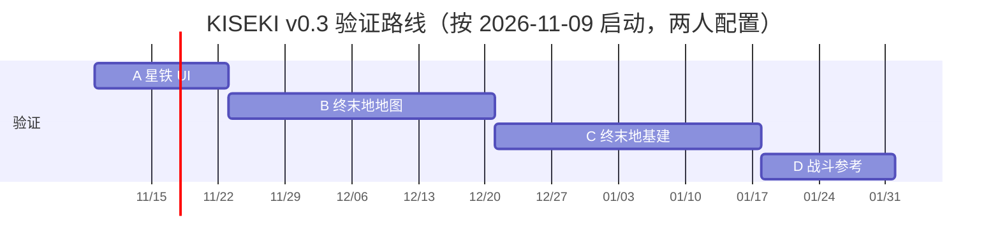

# 02 · 路线图与验收

> 版本 v0.1 · 2026-11-08 · 讨论稿
> 配套：[总体方案](01-总体方案.md) · [实验与数据计划](03-实验与数据计划.md) · [DSH 集成与运行时](04-DSH集成与运行时方案.md)
>
> **v0.3 范围基线（2026-11-08）**：首发 **星穹铁道（UI）** 与 **终末地（地图 > 基建 > 战斗）**；GameScaling 仅作参考；DSH 作为 Agent 基座，主模型云端、只用小号。本文 M2–M4 的原神/ZZZ 里程碑保留为长期规划，**实际执行以 §11 v0.3 修订路线为准**。

---

## 0. 总览

**当前执行路线（v0.3，12 周验证计划）**：

```text
A 星铁 UI（2 周） → B 终末地地图（4 周） → C 终末地基建（4 周） → D 战斗参考（2 周）
```



> **人力假设（重要）**：A 约 10 人日 + B 约 15 + C 约 20 + D 约 5 = 50 人日，加 20% 缓冲 = 60。单人 20 h/周（约 2.5 人日/周）需 20–24 周；两人（合计 5 人日/周）约 12–14 周。所谓“12 周”是两人配置，单人请按 20–24 周排。

**历史基线（v0.1，已不执行）**：24 周、M0–M5、85 人日、原神/ZZZ；保留在 §1–§9 作为方法与评测模板，里程碑细节以 §11 为准。

---

## 1. 里程碑

> 以下 M0–M5 是 v0.1 历史基线（原神/ZZZ、24 周）；当前执行路线见 §11，两者冲突时以 §11 为准。

### M0 · 决胜实验（第 1–2 周）

**目标**：用最小成本回答一个问题——GameScaling 在二次元 3D 动作游戏上，零样本是否"能用"？

**工作项**

- 安装 WSL2 + vLLM，起 2B-S3 服务（16 GB 显存，`gpu-memory-utilization 0.4`）。
- 复用 `vendor/GameScaling/gamescaling` 客户端，跑通"截图 → 请求 → 解析 → 执行"。
- 写一个 200 行捕获/执行循环：WGC 抓帧、SendInput 发键鼠、单调时钟。
- 采集 100 段 × 2 s 的原神/ZZZ 战斗片段（1080p30），离线跑 5 Hz 推理。
- 人工盲评 200 个动作块：合理 / 可接受 / 荒谬（2/1/0）。
- 记录 parse rate、动作有效率、延迟 p50/p95、dropped token。

**交付物**

- `reports/M0-决胜实验.md`（数据 + 结论 + 建议）。
- `src/kiseki/runtime/` 最小捕获/输入循环。
- `tools/replay_actions.py`：把动作块回放到视频上做可视化。

**验收**

| 指标 | 通过线 |
|---|---|
| 动作解析成功率 | ≥ 95% |
| 动作格式有效率（clamp 后仍可执行） | ≥ 90% |
| 人工"合理动作率" | 绿 ≥ 50%；黄 30–50%；红 < 30% |
| 单步延迟 p95 | ≤ 700 ms（2B，共享显存） |
| 回放可视化 | 可用，能定位到帧 |

**退出条件**

- **绿**：进入 M1，同时准备 SFT 数据管线（路径 A→B）。
- **黄**：M1 仍做 HSR（不依赖 L1），L1 只做研究支线；产品 L1 用脚本宏（路径 C）。
- **红**：GameScaling 不进产品路径；M1 照常，L1 用脚本；把 GameScaling 降级为"论文复现/学习"。

---

### M1 · HSR 闭环 MVP（第 3–8 周）

**目标**：在崩坏：星穹铁道上，5 个日常任务端到端跑通，成功率 ≥ 90%。

**工作项**

- Runtime：WGC 捕获、SendInput 输入、焦点保护、急停、录制/回放。
- 感知：模板匹配 + OCR + 屏幕分类器；HSR 10–20 个 UI 锚点；体力/货币/任务字段。
- 状态：`GameState` + SQLite 持久化；UI 状态机；异常弹窗处理。
- 技能：`click_anchor`、`wait_screen`、`claim_all`、`navigate_menu`、`spend_stamina`、`auto_battle` 等 10–12 个。
- 任务：5 个日常（示例：领取邮件、每日签到、清体力（拟造花萼）、委托、领取实训奖励）。
- L3：任务模板 + LLM 填参；先不用自由规划，保证确定性。
- 评测：20 次/任务，成功判定用状态字段 + 截图。
- Dashboard alpha：实时屏幕、状态、任务进度、日志。

**交付物**

- `v0.1` CLI：`kiseki run --profile hsr --task daily_mail`。
- `configs/profiles/hsr.yaml`。
- `reports/M1-验收.md`（20 次 × 5 任务的明细）。
- 5 分钟 Demo 视频。

**验收**

| 指标 | 通过线 |
|---|---|
| 5 个任务成功率（各 N=20） | ≥ 90%（整体） |
| 人工干预 | ≤ 0.5 次/任务 |
| L2 回路 p95 | ≤ 300 ms |
| 崩溃/卡死 | 0 次/20 次运行 |
| 回放 | 每次失败可定位到具体帧与动作 |

**退出条件**：达标 → M2；未达标 → 只保留 3 个最稳的任务，先修稳定性，不扩游戏。

---

### M2 · L1 战斗（第 9–12 周）

**目标**：在原神（或 ZZZ）的战斗场景，把 GameScaling 接成可用的 L1；与脚本宏做 A/B。

**工作项**

- 反射层：服务管理、请求构造、动作解析、6×33 ms 执行器、失败降级。
- 校准：鼠标灵敏度/视角速度/死区；每游戏一份标定。
- 提示词：按 `system_prompt_template.txt` 填 GAME_RULES/KEY_BINDINGS；保留三个标题。
- 数据：录制 5–10 小时战斗（含人工修正），做 SFT 可行性验证。
- 评测：3 个战斗场景 × 20 次；脚本基线 vs GameScaling；胜率/存活/耗时/人工接管。
- 安全：连续解析失败 3 次 → 脚本宏；焦点丢失 → 释放所有键。

**交付物**

- `src/kiseki/reflex/`（客户端 + 执行器 + 校准）。
- `reports/M2-L1-战斗.md`。
- 战斗 A/B 视频。

**验收**

| 指标 | 通过线 |
|---|---|
| 合理动作率（提示词适配后） | ≥ 60% |
| L1 回路 p95 | ≤ 700 ms |
| 战斗胜率 vs 脚本基线 | 不低于基线；目标 +10% |
| 降级成功率 | 100%（失败必回脚本） |

**退出条件**：达标 → L1 进入产品路径；不达标 → L1 仅研究，产品继续脚本；M3 不受阻。

---

### M3 · 第二款游戏 + 自然语言（第 13–16 周）

**目标**：接入原神，累计 20 个任务；用户可用自然语言下达目标；验证"新游戏 ≤ 8 人日"。

**工作项**

- 原神 profile：地图/传送/采集/战斗；小地图定位；A* 导航。
- 技能复用：把 HSR 的 UI 技能抽象成通用原语；新增导航/采集/战斗技能。
- L3：自然语言 → 任务图；知识库 RAG（日常/材料/角色）；情景记忆。
- 多游戏调度：任务队列、账号/游戏切换、失败隔离。
- 评测：2 款游戏 × 10 任务 × 20 次。

**交付物**

- `v0.5`；2 个 profile；20 个任务；`reports/M3-验收.md`。
- "接入新游戏"操作手册 + 工时记录。

**验收**

| 指标 | 通过线 |
|---|---|
| 20 个任务成功率 | ≥ 80% |
| 新游戏接入工时 | ≤ 8 人日 |
| 自然语言目标解析准确率 | ≥ 80%（50 条指令） |
| 跨游戏切换 | 不串状态、不串键位 |

**退出条件**：达标 → M4；接入超 10 人日 → 暂停扩张，先重构抽象。

---

### M4 · 规模、基准与 SFT（第 17–22 周）

**目标**：第三款游戏、40 个任务；完成一次 SFT 对照实验；AnimeGameBench v0.1。

**工作项**

- 第三款游戏（ZZZ 或明日方舟模拟器），接入 ≤ 5 人日。
- SFT：2B-S3 + 自采 20–50k 样本，LoRA/全参对照；评测合理动作率/胜率。
- 基准：3 游戏 × 10–20 任务，300+ episodes；统一成功判定与指标。
- 失败聚类：按屏幕/技能/原因归类，找 Top 10 失败模式。
- 技术报告初稿。

**交付物**

- `AnimeGameBench v0.1`（任务定义 + 评测脚本 + 结果）。
- SFT checkpoint 与实验报告。
- 技术报告初稿。

**验收**

| 指标 | 通过线 |
|---|---|
| 第三款游戏接入 | ≤ 5 人日 |
| 40 个任务成功率 | ≥ 85% |
| SFT 增益 | 合理动作率 +15pp，或战斗胜率 +10% |
| 基准规模 | ≥ 300 episodes，指标齐全 |

---

### M5 · v1.0 发布（第 23–24 周）

**目标**：可交付的 v1.0：文档、安装、Demo、许可证审计、复盘。

**工作项**

- 打包：Windows 安装/便携版；依赖检查；一键启动。
- 文档：README、用户手册、接入指南、FAQ、故障排查。
- 合规：许可证审计（GPL/AGPL 未拷贝）、隐私说明、风险提示。
- Demo：3 分钟视频 + 现场跑 3 个任务。
- 复盘：指标 vs 目标；Kill Criteria 是否触发；下一步。

**验收**

| 指标 | 通过线 |
|---|---|
| 40 个任务成功率 | ≥ 85% |
| 人工干预 | ≤ 0.2 次/任务 |
| 新游戏接入 | ≤ 5 人日 |
| 文档完整度 | 安装/使用/接入/排障四件套 |
| 合规检查 | 无 GPL/AGPL 代码拷贝；无游戏资源分发 |

---

## 2. 前 8 周：A 星铁 UI + B 终末地地图

| 周 | 阶段 | 具体产出 | 验收 |
|---|---|---|---|
| W1 | A | runtime MCP 5 个基础工具；`hsr.yaml`；`dry_run` 走通 | 能截图、点击、急停 |
| W2 | A | 邮件/签到两个技能；20 次/任务 | ≥90%；p95 <3 s/步 |
| W3 | B | 30–50 张地图截图；2D 瓦片；10 个 waypoint | 瓦片可拼接、坐标一致 |
| W4 | B | 定位管线：ORB/SIFT + 单应性 + 光流兜底 | 单帧 ≥95%；误差 ≤2 m |
| W5 | B | 拓扑导航；5 条固定路线 | 4/5 到达 |
| W6 | B | 20 次路线；卡住/偏航恢复 | ≥16/20；卡住 >5 s 失败 |
| W7 | B | 失败分类；补 waypoint/特征 | Top 3 有对策 |
| W8 | B→C | 地图验收；C 的配方/建筑调研 | go/no-go |

> B 阶段不做完整 SLAM、不做多层；C/D 见 §11。地图若在 W6 仍 <3/5，先修定位与拓扑，不进入 C。

---

## 3. 工作分解（WBS，人日）

| WP | 工作包 | 内容 | 人日 |
|---|---|---|---|
| WP1 | Runtime | 捕获 4、输入 3、录制/回放 3、窗口/时钟 2 | 12 |
| WP2 | 感知 | 模板 3、OCR 5、状态融合 3、VLM 兜底 2、小地图/导航 3 | 16 |
| WP3 | 技能 | 框架 3、UI 原语 4、HSR 6、原神 5 | 18 |
| WP4 | 规划 | 工具层 3、任务模板 4、RAG 2、记忆 2、自然语言 1 | 12 |
| WP5 | 反射 | 客户端 2、执行器 3、校准 2、提示词 2 | 9 |
| WP6 | 评测 | Harness 3、任务 3、统计 1、基准 1 | 8 |
| WP7 | 产品 | CLI 2、Dashboard 3、打包 1 | 6 |
| WP8 | 文档/合规 | 文档 2、许可证/隐私 1、Demo 1 | 4 |
| | **合计** | | **85** |

**按里程碑拆分**

| 里程碑 | 人日 | 累计 |
|---|---|---|
| M0 | 10 | 10 |
| M1 | 22 | 32 |
| M2 | 15 | 47 |
| M3 | 18 | 65 |
| M4 | 16 | 81 |
| M5 | 4 | 85 |

> 估算不含"等游戏日常刷新/等活动"的日历时间，也不含封号/环境故障的返工。建议加 20% 缓冲 → **约 102 人日**。

---

## 4. 人力配置与排期

| 配置 | 每周投入 | v0.1（32 人日） | v1.0（102 人日含缓冲） | 建议 |
|---|---|---|---|---|
| A 单人全职 | 5 人日 | 6.5 周 | 20.5 周 | 最快，但无并行、风险集中 |
| B 单人兼职 | 2.5 人日 | 13 周 | 41 周 | **24 周不够**，需砍范围 |
| C 两人兼职 | 5 人日 | 6.5 周 | 20.5 周 | 推荐：一人 runtime/CV，一人 planner/ML |
| D 两人全职 | 10 人日 | 3.5 周 | 10.5 周 | 最快，沟通成本上升 |

**推荐配置 C**：两人各 20 h/周，24 周内完成 v1.0，且每人有明确边界：

- **A（Runtime/感知）**：捕获、输入、录制、模板/OCR、状态、技能原语、性能。
- **B（规划/反射/评测）**：LLM 规划、知识库、记忆、GameScaling 集成、评测与统计。
- **共享**：profile 接入、文档、Demo、每周复盘。

**如果只能单人兼职**：把 v1.0 目标砍到"1.5 款游戏、20 个任务、无 SFT"，24 周可交付；SFT 与基准留到 36 周后。

---

## 5. 预算

| 项目 | 规格 | 估算 |
|---|---|---|
| 云 GPU（开发/评测） | 4090 150 h × ¥4/h | ¥600 |
| 云 GPU（SFT/9B 对照） | H100 20 h × ¥30/h | ¥600 |
| LLM API | 规划/知识库/评测 | ¥800 |
| 存储 | 2 TB NVMe | ¥800 |
| 杂项 | 测试账号、网络、备份 | ¥500 |
| 缓冲 | 20% | ¥660 |
| **合计** | | **约 ¥4,000** |

不含：购机（已有 4090 Laptop）、游戏内购、商业 API 大额调用。若买 4090 台式机，另加 ¥15,000，不是必需。

---

## 6. 评测体系

### 6.1 指标分层

| 层 | 指标 | 定义 | 目标 |
|---|---|---|---|
| L0 | 捕获帧率 | 实际 fps / 目标 fps | ≥ 95% |
| L0 | 输入延迟 | 动作发出 → 系统时间戳 | p95 < 10 ms |
| 感知 | 屏幕分类准确率 | 正确屏 / 总帧 | ≥ 98% |
| 感知 | OCR 字段准确率 | 关键字段全对 / 总数 | ≥ 98% |
| 感知 | 模板失配率 | 未匹配 / 应匹配 | < 5% |
| L1 | 解析成功率 | 可解析动作 / 请求 | ≥ 95% |
| L1 | 合理动作率 | 人工评分 ≥ 1 / 样本 | ≥ 60% |
| L1 | 回路延迟 | 帧 → 动作执行 | p95 < 700 ms |
| L2 | 技能成功率 | 后置条件通过 / 调用 | ≥ 95% |
| L2 | 回路延迟 | 感知 → 动作 | p95 < 300 ms |
| L3 | 任务图正确率 | 与人工标注一致 | ≥ 85% |
| 端到端 | 任务成功率 | 成功 / N | v0.1 ≥ 90%，v1.0 ≥ 85%（40 任务） |
| 端到端 | 人工干预 | 次数 / 任务 | ≤ 0.2 |
| 端到端 | 平均耗时 | 任务开始 → 结束 | 与人工基线 ±20% |
| 稳定性 | 崩溃/卡死 | 次 / 20 次运行 | 0 |
| 成本 | 单任务 API/GPU 成本 | 元 / 任务 | < ¥0.5 |

### 6.2 任务基准

**HSR（20 个）**：邮件、签到、实训奖励、委托、清体力（花萼/历战余响）、每日任务、周本、模拟宇宙（简化）、忘却之庭（简化）、角色试用、活动领取、商店兑换、材料合成、派遣、好友赠送、成就领取、图鉴领取、版本礼包、抽卡（只读提示，不自动抽）、退出。

**原神（10 个）**：每日委托 ×4、清体力（秘境/地脉）、派遣、尘歌壶领取、活动领取、采集路线、周本。

**ZZZ/明日方舟（10 个）**：日常、清体力、活动、基建/制造站、周常、战斗、委托、商店兑换、派遣、奖励领取。

> 每个任务必须有：起始状态、成功判定、超时、重置方式、风险级别（是否消耗货币/抽卡）。

### 6.3 统计方法

- 成功率用 **Wilson 95% 置信区间**，不用裸比例。
- N=20 用于迭代（p=0.9 时 CI 约 ±13%）；发布用 N=50（CI 约 ±8%）。
- A/B 对比用同任务、同账号、同时间段，交替运行，避免日常刷新偏差。
- 消融：去掉 OCR / 去掉 L3 / 去掉 L1 / 去掉记忆，各测 10 次，看成功率与耗时。
- 失败必须归类：感知错、技能错、规划错、游戏异常、环境异常、未知。

### 6.4 重置与可复现

- 用测试账号；任务开始前记录状态快照（体力/货币/任务进度）。
- 日常类任务依赖服务器刷新，评测安排在刷新后 2 小时内。
- 战斗类任务用固定副本/固定队伍/固定难度；记录角色/装备/网络。
- 无法重置的任务（周常）单独统计，不混入日常成功率。

---

## 7. 风险登记册

| ID | 风险 | 概率 | 影响 | 触发信号 | 对策 |
|---|---|---|---|---|---|
| R1 | 反作弊/封号 | 高 | 高 | 输入被吞、异常检测、封号通知 | Copilot 默认；测试号；不读内存/不注入；随机化时序；封号即停 Autopilot |
| R2 | GameScaling 二游域迁移差 | 中高 | 高 | M0 合理动作率 < 30% | 脚本 L1 保底；SFT 仅在黄/绿时投入；不把产品押在模型上 |
| R3 | 延迟不达标 | 中 | 中 | L1 p95 > 700 ms | 换 0.8B；减历史帧/分辨率；异步；云推理 |
| R4 | UI 更新/活动变化 | 高 | 中 | 模板失配率 > 10% | profile 版本化；VLM 兜底；自愈；快速热修 |
| R5 | OCR 失败 | 中 | 中 | 关键字段 CER > 5% | 多引擎；预处理；字典纠错；VLM 兜底 |
| R6 | 规划幻觉/误操作 | 中高 | 高 | 错误点击、消耗货币 | 技能白名单；二次确认；dry-run；预算上限 |
| R7 | 数据/隐私/版权 | 中 | 中 | 分享录屏含 UID | 本地存储；脱敏；不分发游戏资源 |
| R8 | 单人范围蔓延 | 高 | 高 | 连续 3 周无里程碑 | 8 周 MVP；Kill Criteria；每周复盘 |
| R9 | GPL/AGPL 传染 | 中 | 中 | 拷贝 BetterGI/MAA 代码 | 只参考架构；自研；许可证审计 |
| R10 | 硬件不足（16 GB） | 中 | 中 | OOM、降频、游戏掉帧 | 2B/4bit；云 GPU；分离推理机 |
| R11 | 游戏版本/区服差异 | 中 | 中 | 同一任务在别的号失败 | profile 带版本/区服；启动自检 |
| R12 | 时间投入不足 | 高 | 高 | 周投入 < 10 h | 砍范围；找队友；延长到 36 周 |

---

## 8. Kill Criteria（停止/转向规则）

| 条件 | 动作 |
|---|---|
| M0 合理动作率 < 30% | GameScaling 只做研究，产品 L1 用脚本；不投入 SFT |
| M1 第 6 周 5 任务整体 < 70% | 缩到 3 个任务；仍不达标则换游戏（ZZZ/明日方舟模拟器） |
| 新游戏接入 > 10 人日 | 暂停扩张；重构 profile/技能抽象；2 周内不碰新游戏 |
| 出现封号（测试号） | 立即停该账号 Autopilot；只做 Copilot；复盘输入路径 |
| 连续 3 周无里程碑 | 砍 30% 范围；或改为 2 人；或延长到 36 周 |
| 数据/存储成本超预算 2 倍 | 降分辨率/帧率；只留关键片段；清理原始视频 |
| 单人连续 2 周 < 10 h | 正式改为"兼职 36 周计划"，不假装 24 周 |

---

## 9. 每周节奏

| 时间 | 事项 | 产出 |
|---|---|---|
| 周一 30 min | 定本周 3 个目标 + 风险 | 周计划（1 页） |
| 周三 15 min | 中期检查：卡点/需要决策 | 调整记录 |
| 周五 60 min | Demo + 指标 + 复盘 | 周报（指标表 + 失败 Top 3） |
| 每两周 | 里程碑评审 | 验收表 + go/no-go |
| 每四周 | 风险登记册更新 | 风险表 + 对策 |

**工程约定**

- `main` 保护；功能分支；PR 至少自审 + 测试。
- 每个技能/任务有单测或回放测试；不允许"只能手动验证"的合并。
- 配置文件版本化；profile 变更记录 changelog。
- 日志默认脱敏（UID/昵称），分享前再检查。

---

## 10. 第一周就能开始的 7 件事（v0.3）

1. 建 `C:\AI\anime-game-agent\.venv`，装 `opencv-python`、`numpy`、`mss`、`pydirectinput`；MCP 用官方 SDK 或 zero-dep JSON-RPC（见 04）。
2. 写 `game_profiles` / `game_focus` / `game_capture` / `game_act` / `game_stop` 五个工具，先用记事本验证截图、点击、前台校验。
3. 在 `cordis.patch.yml` 的 `insert:` 下加 `mcp-kiseki`，重启 DSH，确认工具出现在对话里。
4. 用 `dry_run` 在星铁登录界面走一遍：截图 → 识别 → 点击 → 再截图；不碰账号操作。
5. 写 `configs/hsr.yaml` 的窗口/锚点/OCR 区域，先只做“主界面 → 邮件 → 领取 → 返回”。
6. 跑 5 次邮件任务，记录失败原因；修到 5/5 再扩到 20 次。
7. 终末地只做一件事：跑图截 30 张小地图，标 10 个 waypoint；不碰战斗、不碰基建。

> 第一周不要装 WSL、不要拉 vLLM、不要训模型。先把“DSH 能看见、能点、能停”跑通；这是后面所有工作的地基。

---

## 11. v0.3 修订路线（12 周验证计划）

> 这是一条“先证明 DSH 能操作、再证明能理解地图/基建”的验证路线，不是完整产品路线。目标是在 12 周内拿到三个 go/no-go 结论。人力换算见本节末。

| 阶段 | 周 | 目标 | 验收（go） |
|---|---|---|---|
| A 星铁 UI | 1–2 | runtime + 邮件/签到 | 每任务 20 次 ≥90%；p95 <3 s/步；干预 ≤0.2 次 |
| B 终末地地图 | 3–6 | 2D 瓦片 + 20–30 waypoint + 定位 | 5 条路线 4 条成功；卡住 >5 s 失败；置信度 <0.6 暂停 |
| C 终末地基建 | 7–10 | 配方图 + 状态模型 + 一条产线 | 30 min 内建成；产率 ±20%；5 min 无堵塞；电力裕度 ≥10%；干预 ≤2 |
| D 战斗参考 | 11–12 | GameScaling 2B 零样本 | parse/valid/sensible 记录；不投入 SFT；只作参考 |

**阶段说明**

- **A（2 周，约 10 人日）**：9 个 MCP 工具、`hsr.yaml`、邮件/签到两个技能；先 `dry_run` 后真点；20 次/任务。星铁只测 UI，不碰战斗、不碰抽卡。
- **B（4 周，约 15 人日）**：自己跑图截 30–50 张，拼 2D 瓦片；20–30 个 waypoint；ORB/SIFT + 单应性 + 光流兜底；5 条固定路线；不做完整 SLAM，不做多层（先单层）。
- **C（4 周，约 20 人日）**：`recipes.yaml`；基建状态模型；布局约束检查；一条“2 采集 → 1 加工 → 1 输出”的产线；失败回滚；监控产量/堵塞/电力。
- **D（2 周，约 5 人日）**：20 段 ×2 s 战斗，5 Hz、5 帧历史；只记录 parse/valid/sensible 与延迟；<30% 就只保留脚本兜底，不再投入模型。

**人力换算**：A 10 + B 15 + C 20 + D 5 = 50 人日；加 20% 缓冲 = 60 人日。单人 20 h/周（约 2.5 人日/周）需 20–24 周；两人（合计 5 人日/周）约 12–14 周。所谓“12 周”是两人配置下的验证节奏，单人请按 20–24 周排。

**Go/No-Go**

- A 失败（<70%）→ 缩任务或换 UI，检查 runtime，不进入 B。
- B 失败（<3/5 或频繁卡住）→ 先修定位/拓扑，不进入 C。
- C 失败（产线建不成/严重堵塞）→ 回到“单建筑放置 + 配方”小目标，不扩基地。
- D 失败（<30%）→ 战斗只保留脚本兜底，不再投入模型。
