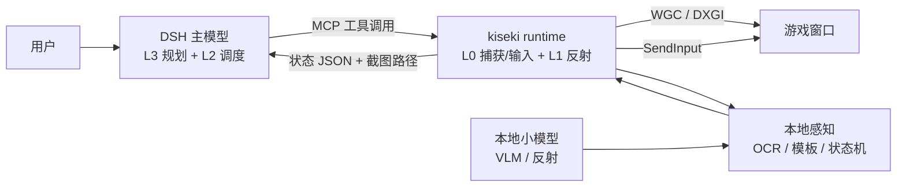

# 04 · DSH 作为 Agent 基座：集成与运行时方案

> 版本 v0.3 · 2026-11-08
> **已确认**：主模型继续云端；只用小号；先做星铁 UI；终末地按 **地图 > 基建 > 战斗** 排序；GameScaling 仅作参考。
> **范围变更**：GameScaling 仅作参考；首发 **崩坏：星穹铁道（只测 UI）** 与 **明日方舟：终末地（地图 / 基建 / 战斗）**；其余游戏只做规划。Agent 基座用 DSH，本地只部署小而快的模型作补充。
> 本文件取代 [01-总体方案](01-总体方案.md) 与 [02-路线图与验收](02-路线图与验收.md) 中关于“首发游戏 / GameScaling 作为起点”的部分；01 的四层架构、02 的评测方法、03 的数据协议仍然有效。

---

## 0. 结论

**可以，而且这是目前最省力、最符合你现有环境的路线。** 但要把一句话说准确：

> DSH 可以当“大脑 + 调度器”，不能当“眼睛 + 手 + 反射神经”。

DSH 现在没有截屏、鼠标、键盘工具，也没有本地模型 provider；它擅长的是理解目标、选工具、读结果、处理异常、向用户解释。要让它“操作电脑玩游戏”，必须补一个**本地游戏运行时**，把捕获、输入、状态识别、技能执行、地图定位封装成 MCP 工具，挂到 DSH 的 profile 里。补上这一层之后，用户在对话里说“帮我把星铁邮件领了”，DSH 就能完成；不补这一层，DSH 只能“说”，不能“做”。

三个不要：

1. **不要让 DSH 主模型进 5 Hz 回路。** 一次工具调用 = 模型往返 + 工具执行，现实 p95 是 1–3 秒；UI 任务够用，战斗不够。
2. **不要用本地 4B 模型替代 DSH 主模型。** 本地小模型适合 OCR、图标检测、屏幕语义、战斗反射；当长程规划器会明显变笨，工具调用也更容易错。
3. **不要让 LLM 直接生成 `pyautogui` 代码或坐标。** 让它选技能、填参数；坐标和按键由 Game Profile 与技能层决定，才能复用、才能审计、才能防误操作。

最小可行闭环 = **9 个 MCP 工具 + 1 个 Game Profile + 2 个确定性技能**。按你的决策，路线收敛为：**2 周星铁 UI → 4 周终末地地图 → 4 周终末地基建 → 战斗只做参考实验**。GameScaling 不进入主路径，也不先做 SFT。

---

## 1. DSH 能力核对（2026-11-08 实测）

| 能力 | 现状 | 对项目的含义 |
|---|---|---|
| 版本 / 入口 | DSH 0.2.1-rc.5，Web GUI `http://127.0.0.1:59174` | 可直接作为交互前端 |
| MCP stdio client | 已启用；profile 里已有 `mcp-fish`、`mcp-fetch` 两个条目 | 本地 runtime 可以按同样方式挂载 |
| 工具 / 技能 / 子代理 / 会话 | 有 | L3 规划、L2 调度、异常处理都能用 |
| 截屏 / 鼠标 / 键盘 | **没有**原生工具；只有 `read_image` 能读本地图片 | 必须自建 runtime，这是唯一硬缺口 |
| 本地模型 provider | **没有**；`list_subagent_models` 只有 `deepseek-account` | 本地模型只能通过 MCP 工具暴露，不能当 DSH 主模型 |
| 实时回路 | 不支持 5 Hz 级工具循环 | 战斗/跑图必须下沉到 runtime |
| 插件面 | 229 项，含 sandbox/approval/jobs/skill/subagent 等 | 不需要 fork DSH，按插件 + MCP 扩展即可 |
| 默认权限 | `danger-full-access`、`approval: never` | 必须在 runtime 侧做窗口/动作白名单，不能靠审批兜底 |

**关键结论**：DSH 的缺口只有一个——没有“游戏 I/O”。这个缺口不需要改 DSH 内核，用 MCP server 补即可；这也意味着项目不再是“做一个 Agent 框架”，而是“给 DSH 接一套游戏运行时”。

DSH 的 profile 由 Electron 管理，不能直接 `dsh --profile desktop --dump-config`；新增 MCP 条目要写进 `<HOME>\.dsh\profiles\desktop\cordis.patch.yml` 的 `insert:` 下，然后重启 DSH。示例：

```yaml
- insert:
    - id: mcp-kiseki
      name: '@deepseek-ai/dsh-mcp-client'
      config:
        serverName: kiseki
        transport: stdio
        command: C:/AI/anime-game-agent/.venv/Scripts/python.exe
        args:
          - -m
          - kiseki_runtime.mcp_server
        cwd: C:/AI/anime-game-agent
        env:
          # src layout: 以模块方式启动必须把 src 放进 PYTHONPATH，否则 import 失败
          PYTHONPATH: C:/AI/anime-game-agent/src
          PYTHONIOENCODING: utf-8
          PYTHONUTF8: '1'
        toolCallTimeoutMs: 30000
        failOnStartupError: false
```

不要直接改 `cordis.yml`（当前是空列表，实际配置由 bundle 合成）；`failOnStartupError: false` 会让启动失败变成静默，所以 runtime 必须提供 `game_health` 或在 `game_profiles` 里返回自检信息。

---

## 2. 目标架构



| 层 | 谁来做 | 频率 | 职责 |
|---|---|---|---|
| L3 规划 | DSH 主模型（云端 `deepseek-flash`） | 0.2–1 Hz | 理解目标、拆任务、选技能、异常归因、向用户解释 |
| L2 技能 | runtime 的状态机 / 行为树；DSH 只选技能和填参 | 1–5 Hz | 领邮件、签到、清体力、传送、采集、战斗循环 |
| L1 反射 | 本地脚本 / 小模型（GameScaling 2B 等） | 5 Hz | 战斗微操、跑图避障、镜头控制 |
| L0 运行时 | runtime 的 capture / input / clock / recorder | 30–60 fps | 截图、注入输入、单调时钟、录制回放 |

**数据流**：DSH 调 `game_state` 拿到紧凑 JSON（当前界面、可点按钮、资源数量、任务进度）→ 选技能 → `game_skill` 执行 → `game_status` 轮询 → 失败时 `game_capture` 拿一张图，用 `read_image` 看细节 → 重新规划或问用户。正常路径不传图片，只有异常路径才传，避免上下文被截图撑爆。

**为什么不让 DSH 每步“截图→看图→点击”**：星铁一个日常 30–80 步，每步一次模型往返 + 一张图，成本高、延迟 1–3 秒/步，而且模型容易在相似按钮上点错。正确做法是“技能层执行，DSH 监督”；只有技能未覆盖的新界面才走逐步视觉。

---

## 3. MCP 工具面（9 个，不再多）

工具面要少而语义化。每个工具都返回**紧凑 JSON**，需要图片时只返回本地路径，由 DSH 用 `read_image` 按需读取；不要返回 base64。

| 工具 | 作用 | 关键返回 |
|---|---|---|
| `game_profiles` | 列出已安装的 Game Profile 与自检状态 | `id/name/games/health` |
| `game_focus` | 找到游戏窗口、检查前台、返回窗口矩形与 DPI | `hwnd/rect/dpi/foreground` |
| `game_capture` | 捕获窗口或区域到 PNG | `path/width/height/ts` |
| `game_state` | 跑 profile 的状态提取器：界面 ID、OCR、锚点、资源、按钮可用性 | `screen/fields/anchors/ocr/confidence` |
| `game_act` | 点击 / 按键 / 文本；目标用 anchor 或归一化坐标 | `before/after` 截图路径、`ok` |
| `game_skill` | 执行命名技能（状态机/行为树），带参数与超时 | `run_id` |
| `game_status` | 查询/取消技能运行，返回进度、最后错误、轨迹 | `state/progress/error/trace` |
| `game_map` | 小地图定位 / 路线规划：`localize` 或 `route` | `x/y/heading/confidence` 或 `waypoints` |
| `game_stop` | 释放所有按键、停止技能、解除鼠标按下 | `ok` |

**工具设计规则**：

- 每个输入类工具在执行前检查前台窗口是否为 profile 指定窗口；不是就返回 `WINDOW_NOT_FOREGROUND`，不注入任何输入。这条必须由 runtime 强制执行，不能靠模型自觉。
- `game_act` 只接受 profile 中声明的 anchor 或 0–1 归一化坐标；不接受屏幕绝对像素、任意脚本、任意 shell。
- `game_skill` 是确定性代码，不是模型生成；模型只能从注册表里选 `skill_id` 并填参数。新增技能要改代码/配置，不能由模型现场写。
- 所有工具都要有超时、取消、幂等语义；`game_capture`/`game_state` 可重试，`game_act` 不可盲目重试（点击可能已生效）。
- 默认 `dry_run` 可用：`game_act` 只返回“将会点哪里”，不真正点击；第一周调试必须用这个模式。
- 需要用户确认的动作（消耗付费货币、抽卡、删除、PVP）在 profile 里标 `confirm: true`，runtime 直接拒绝，不交给模型判断。

**技能注册表示例**（`configs/hsr.yaml` 里只放声明，代码在 `src/kiseki_runtime/skills/`）：

```yaml
skills:
  claim_mail:
    description: 领取星铁邮件中的全部附件
    params: {}
    timeout_s: 60
    steps:
      - {state: hsr_home}
      - {click: mail_icon}
      - {click: claim_all}
      - {click: close}
```

---

## 4. 本地模型分工（16 GB 显存）

| 模型 | 任务 | 显存 | 延迟 | 何时用 |
|---|---|---|---|---|
| PP-OCRv5 mobile / RapidOCR | UI 文本、按钮字、任务描述 | CPU 为主，<1 GB | 20–50 ms/区域 | 每次 `game_state` |
| YOLO11n（自训 UI 检测） | 图标、按钮、体力/货币图标 | 1–2 GB | 10–20 ms | 锚点不稳定时兜底 |
| Qwen2.5-VL-3B/4B（4bit） | 屏幕语义理解、未知界面描述 | 3–4 GB | 0.5–2 s | 技能未覆盖、需要“看懂”时 |
| GameScaling 2B-S3 | 终末地战斗反射（后置） | 5.4 GB（bf16） | 200 ms/块 | 只在战斗参考实验，不排期 |
| Qwen3-4B（4bit，可选） | 意图分类、短文本判断 | 2.5–3 GB | 100–300 ms | 可选，不替代 DSH |

**调度原则**：

- 不要同时常驻所有模型。星铁 UI 线只需要 OCR + 模板匹配，CPU 就够；终末地地图/基建也用 OCR + 模板 + 轻量 VLM；GameScaling 2B 只在战斗参考实验时加载。
- 游戏本身要吃显存；模型加载后把游戏画质/分辨率降到 1080p 中低，给模型留 6–8 GB。
- 16 GB 跑 9B bf16（18.8 GB）不可行；9B 4bit 约 5–6 GB，但二游域零样本本来就不稳，第一版不碰 9B。
- 本地 4B 当 DSH 主模型是降级，不是等价替换；如果以后要离线，单独加一个 OpenAI-compatible provider 插件，不要现在做。

---

## 5. 时延预算

| 回路 | 频率 | 预算 | 负责 |
|---|---|---|---|
| 捕获 | 30 fps | 33 ms | runtime（WGC/DXGI） |
| UI 技能循环 | 2–5 Hz | 200–500 ms/步 | runtime |
| OCR | 1–2 Hz | 20–50 ms/区域 | runtime |
| DSH 决策 | 0.2–1 Hz | 1–3 s/次 | DSH 主模型 |
| 战斗反射（后置） | 5 Hz | 200 ms/块 | 本地模型 + runtime |
| 地图定位 | 5–10 Hz | 50–100 ms | runtime |
| 地图路径规划 | 0.2 Hz | 1–2 s | DSH / runtime |

星铁是回合制 + 重 UI，1–3 秒/步完全可接受；终末地优先是地图/基建，战斗 5 Hz 只在参考实验中验证。DSH 负责进入/退出战斗与目标选择，微操交给本地模型或脚本。

---

## 6. 星穹铁道：只测 UI

**范围**：邮件、每日签到、体力清理，3 个任务；先做邮件，再做签到，最后体力。

**验收**：

- 每个任务跑 20 次，成功率 ≥90%；失败必须能给出原因（界面没识别、按钮不可用、超时、网络）。
- 单步 UI p95 <3 s；整任务 p95 <90 s（不含战斗）。
- 人工干预 ≤0.2 次/任务；需要干预时 DSH 能说清楚卡在哪。
- 录 10 次完整运行，供失败复盘。

**为什么先星铁**：UI 稳定、步骤确定、动作频率低，最适合验证 runtime 的捕获/输入/状态机，而不是验证模型。它也是“DSH 能不能操作电脑”的最小证明。

**流程示例**：`game_focus` → `game_state` 识别主界面 → `game_skill(claim_mail)` → `game_status` 轮询 → 完成；如果 `game_state` 置信度低，`game_capture` + `read_image`，DSH 判断后继续或问用户。

**风险**：星铁有反作弊/ToS 风险；只用测试账号，出现异常提示立即停；不做 PvP、不读内存、不注入 DLL。

---

## 7. 终末地：地图 > 基建 > 战斗

优先级按你的判断调整：**地图与基建是特色玩法，先做；战斗降为参考实验**。这不是降低难度，而是把项目从“拼反应”拉回“理解 + 规划 + 空间执行”，更匹配 DSH 的长处。

### 7.1 地图（第一优先）

1. 自己跑图采 30–50 张小地图/地图界面截图，拼 2D 瓦片；不要直接搬社区地图（版权与坐标不一致）。
2. 手工标 20–30 个 waypoint（传送点、路口、资源点、基建入口），建拓扑图；节点带 `layer`，先支持单层。
3. 小地图裁切 → ORB/SIFT + 单应性，匹配到瓦片，输出 `x/y/heading/confidence`；卡通渲染特征点少时用模板块 + 光流兜底。
4. 目标“去最近传送点/采集点/基建入口” → DSH 选节点 → runtime 按 waypoint 走 → 偏航或卡住时重定位。
5. 偏航 >2 m 或卡住 >3 s 触发重定位；连续 3 次失败暂停问用户；置信度 <0.6 不硬走。
6. 验收：5 条路线，2 倍人类时间內到达；卡住 >5 s 算失败；先做 2D，不做完整 SLAM。

### 7.2 基建（第二优先）

这是比战斗更适合 Agent 的“理解 + 推理”测试：配方图、产能配比、空间布局、物流连接、电力/水源、瓶颈诊断。

1. **状态模型**：从基建总览/建造界面 OCR + 模板，抽 `buildings[]`（类型/等级/坐标/朝向/配方）、`inventory`、`power`、`water`、`logistics`、`bottlenecks`。
2. **配方图**：静态知识库 `recipes.yaml`：输入/输出/建筑/耗时/功率/占地/连接口；LLM 只做配比与布局建议，数值用确定性计算。
3. **布局规划**：LLM 给分区/产线草案；约束检查器验证网格、占地、连接、电力、物流；不通过就重排。
4. **执行**：相机对准 + 建造菜单 + 网格放置/旋转/连接；每一步截图/状态校验；失败回滚。
5. **监控**：产量、堵塞、缺电/缺水；DSH 解释瓶颈并重规划。
6. **验收**：从零建一条目标产线（例如 2 采集 → 1 加工 → 1 输出），30 分钟内完成；目标产率 ±20%；连续 5 分钟无堵塞；电力裕度 ≥10%；人工干预 ≤2 次。
7. 先做“一条简单产线”，不要一上来全自动基地。

### 7.3 战斗（参考实验，不排期）

- GameScaling-2B-S3 零样本，20 段 ×2 s，记录 parse/valid/sensible/latency；只作为“L1 可行性”参考，不投入 SFT，不阻塞地图/基建。
- 如果地图/基建提前稳定，再考虑 5–10 小时数据 LoRA；否则战斗用脚本/行为树兜底。

---

## 8. BetterGI 的地图为什么不够，Agent 的增量在哪

BetterGI 的地图能力建立在**模板匹配 + 固定路线**上：已知区域、固定分辨率、固定 UI 下很稳，但遇到新区域、多层地图、遮挡、动态障碍、语义目标（“去最近的传送点再采集”）就退化。它的路线是录好的，不会因为“前面堵了/传送点没开/天气变了”重新规划；也没有置信度，错了只能重跑。

Agent 的增量不是“换一个更强的模板匹配”，而是四件事：

1. **视觉定位**：小地图 → 地图瓦片/正射图，ORB/SIFT + 单应性，输出位姿 + 置信度；低置信度主动问人，而不是硬走。
2. **拓扑图**：节点是地标/传送点/资源点，边是可通行路径与代价；不是像素级地图，天然支持换区域、换游戏。
3. **语义层**：DSH 读地图 OCR/区域名，把“去最近传送点”映射到节点；知识库提供“这个点位怎么开”的攻略。
4. **重规划**：偏航、卡住、目标不可达时重新定位、换路径、解释原因；这是固定路线脚本没有的。

这也解释了为什么“只加一个更强的小模型”不够：地图问题主要是**状态估计 + 拓扑推理 + 重规划**，不是图像分类。GameScaling 也帮不上地图，它没有绝对坐标点击。

---

## 9. 两周 MVP（星铁 UI）

### 第 1 周：把“手”接上

- 建 `.venv`，安装 `opencv-python`、`numpy`、`mss`、`pydirectinput`；MCP 可用官方 `mcp` SDK，也可照 fish 的零依赖 JSON-RPC 写法（避免 `mcp 2.3` 升 starlette 破坏现有环境）。
- 实现 `game_profiles`、`game_focus`、`game_capture`、`game_act`、`game_stop`，先不接游戏，用记事本 + 星铁登录界面测。
- 加前台窗口校验、`dry_run`、紧急停止（F12 释放所有键）。
- 写 `cordis.patch.yml` 条目，重启 DSH，确认工具出现在对话里。

### 第 2 周：把“一个任务”跑通

- 写 `configs/hsr.yaml`：窗口、锚点、OCR 区域、3 个界面、`claim_mail` 技能。
- `game_state` 识别主界面/邮件/签到；`game_skill` 执行；`game_status` 轮询。
- 邮件任务跑 20 次，记录成功率、耗时、失败原因；修到 ≥90%。
- 并行：终末地开始跑图，采 30–50 张小地图/地图界面截图，做 2D 瓦片与 20–30 个 waypoint；不碰战斗。

**交付物**：

- `src/kiseki_runtime/mcp_server.py`
- `configs/hsr.yaml`
- `configs/endfield-map.yaml`
- `reports/A-HSR-UI.md`
- `reports/B0-Endfield-Map-Data.md`（B 阶段完整报告 `reports/B-Endfield-Map.md` 在第 6 周出）

**两周之后**：第 3–6 周地图闭环；第 7–10 周基建产线；第 11–12 周战斗参考实验与收尾。具体验收见 [02](02-路线图与验收.md) 的 v0.3 修订。

---

## 10. 风险与边界

| 风险 | 级别 | 处理 |
|---|---|---|
| 反作弊 / ToS | 高 | 只用测试账号；出现异常提示立即停；不做 PvP、不读内存、不注入 DLL、不绕反作弊 |
| 输入焦点 / 全屏捕获 | 中 | 游戏用无边框窗口；每次输入前校验前台窗口；DSH 放第二屏/手机 |
| MCP 崩溃/静默失败 | 中 | `game_profiles` 返回 health；日志落盘；启动失败要显式报错 |
| 模型幻觉误点 | 中 | 技能白名单；`dry_run`；付费/删除类动作 runtime 直接拒绝 |
| 截图撑爆上下文 | 中 | 常规只传状态 JSON；图片只在异常时传，且裁区域 |
| 显存争用 | 中 | 模型按需加载；游戏降画质；一次只跑一个视觉模型 |
| GPL/AGPL 传染 | 低 | BetterGI/MAA 只参考架构，不拷代码 |

---

## 11. 决策状态

**已确认（2026-11-08）**：

1. **主模型**：继续云端 `deepseek-flash`；本地只做 OCR/小 VLM/反射，不替代主模型。
2. **账号**：只用小号；出现异常提示立即停。
3. **优先级**：先星铁 UI（2 周）；终末地 **地图 > 基建 > 战斗**；战斗只做参考实验，不排期。

**仍待确认**：

1. **MCP 实现**：官方 `mcp` SDK（开发快）还是 zero-dependency JSON-RPC（不破坏现有 fastapi 环境）？
2. **默认形态**：Copilot（只读提示/高亮）还是 Autopilot（注入输入）？小号上可以先 Autopilot，但默认值要定。
3. **时间投入**：单人 20 h/周，还是有 1–2 位队友？按 12 周验证计划，单人 20 h/周约需 20–24 周。

前两条不影响第 1 周开工；第 3 条决定是否压缩范围。
